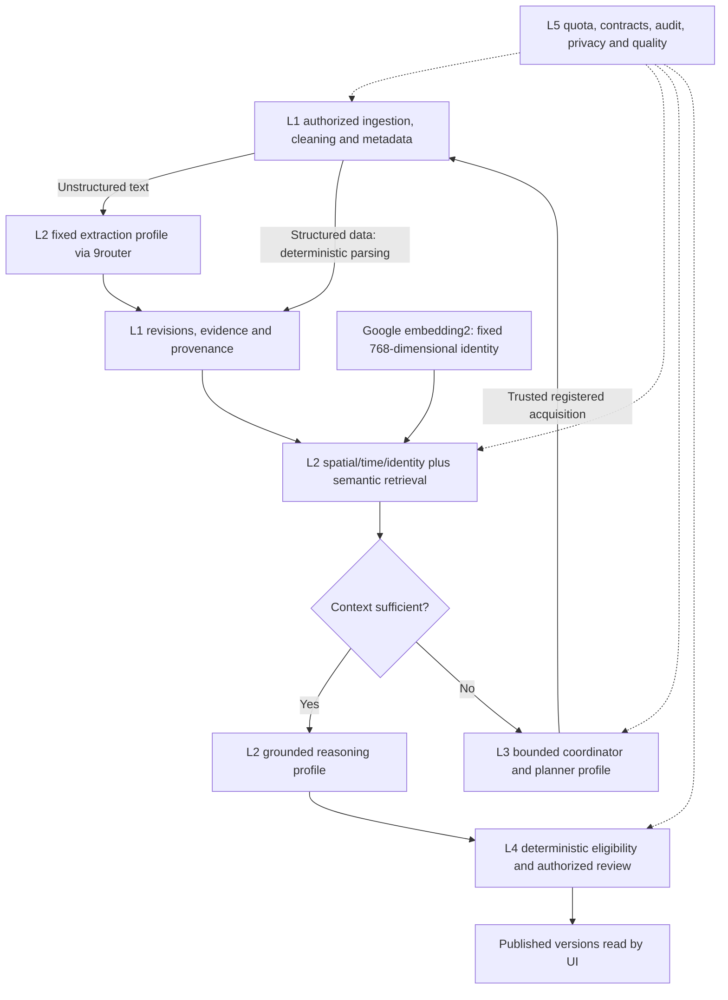

# AI pipeline model integration plan

Status: local provider adapter/CLI and durable long-wait composition accepted; production readiness remains gated, updated12 October2026. Google Gemini Embedding2 and the user's weekly curated Chinese preview model supersede earlier Cloudflare candidates. Both routes and768-dimensional embedding are verified. Neither full live smoke passed; the latest v2 run accepted classification, embedding, sufficient-context reasoning and planner, but extraction timed out. A later three-request local synthetic attempt completed extraction, embedding, persisted retrieval/grounding, reasoning and private persistence with a zero-claim/one-unresolved result. Root current pipeline58/58, Worker519/519, evaluation/AI41/41, typecheck/build/dry-run/smoke and three actual-result browser groups pass. Public Worker/map paths remain provider-free. No dependency, model download, credential file, router/Tailscale setting, binding or hosted service was changed. See [actual probes and boundaries](PRIVATE_AI_GATEWAY_TESTING.md).

## Model roles

The first user-requested no-client-deadline extraction diagnostic returnedHTTP200 after75.773seconds, then failed as `invalid_response` / `provider_error`. A separately authorized rerun using `--omit-output-limits` sent only model/messages/stream and passed schema2.0/source-lineage checks after6.499seconds, with927 input /555 output /1,482 total reported tokens. Each made one synthetic extraction request without retry. The latter skips the old4,096 output allowance only for this diagnostic; the12,000 total-token application validation remains and no limit is sent to the model. Numeric/default deadlines remain configured. The successful sample does not establish the cause of the earlier failures, semantic quality or complete live-pipeline readiness. See [actual evidence and command](PRIVATE_AI_GATEWAY_TESTING.md).

The [local private pipeline](LOCAL_PRIVATE_PIPELINE.md) composes authored-feed collection, file-backed PGlite L1 evidence and typed L2 extraction/embedding/grounding with canonical private proposals. A separate read-only Node service and development/demo app view inspect stored jobs, versioned evidence, contrary references and proposal state. Routine checks use deterministic model doubles; public Worker/map APIs remain provider-free. Separately opt-in 9router once/resume commands reserve at most three requests and now default to900,000ms per request/901,000ms processor fallback, renewing the exact five-minute lease every60seconds during long waits. Backend-only `NINEROUTER_TIMEOUT_MS` permits1000..900000; explicit25000 retains the old profile for historical inspection. Timeout and extraction output policy are part of state ownership. Worker/smoke/L3 defaults remain unchanged. The profile pins requested configuration, not the rotating upstream weights.

The first durable pipeline probe failed at transport; L1 remained intact and AI stayed recoverable with no receipts/proposal. Its cause remains unknown. The later long-wait attempt made exactly three HTTP200 calls: extraction45.717s, embedding0.961s, reasoning22.539s. It renewed once and persisted all five stage receipts plus a private proposal with **zero claims and one unresolved item**, with no publication rows or automatic retry. Read-only desktop/mobile inspection confirmed that result and unchanged data after refresh. The sample proves typed composition, not useful-claim or semantic quality, and does not prove the earlier failure cause. Global16-row/8-result retrieval, terminal predecessor repair, human quality evaluation, global quota accounting, real-source transfer rights, hosted concurrency, L3 dispatch and L4 activation remain gates. See [actual evidence](PRIVATE_AI_GATEWAY_TESTING.md).

| Capability | Selected testing direction | Contract and bounds |
| --- | --- | --- |
| Embedding | User-selected `gemini/gemini-embedding-2-preview` through 9router; earlier research used stable `gemini-embedding-2` | Request 768 dimensions/cosine and one raw evidence chunk per request. Exact route/model/dimension/index identity is preserved. No substitution to the stable route, cross-model fallback or mixing vector spaces. Query embeddings remain a separate future port. |
| Classification/extraction | `Waspada-Jakarta` combo, user-curated Chinese preview selection | Distinct short task profiles. Catalog declares 128,000 context; actual upstream capacity is not independently established. Extract supported category/tags/time/scope/evidence fields; claims belong to reasoning. Exact Unicode source spans, application schema validation and explicit unknowns remain required. |
| Grounded reasoning | Same curated model, separate profile | L2 retrieves evidence first, preserves contrary evidence/time/source status and invokes reasoning only on sufficient context. Output is a proposal or abstention, with no publication authority. |
| Investigation plan selection | Same curated model, separate planner profile | Only on insufficient L2 context. Suggest one trusted-menu action or abstention; L3 validates, reserves budget and dispatches registered tools. New acquisitions return through L1/L2. |

Two model families are enough for this test setup. The Chinese model is a rotating selection, not a permanently chosen brand. The user's unmetered access and 128k floor are recorded as supplied facts; provider throughput, output reliability, exact context limits and version availability are not independently measured. No additional classifier, reranker, fine-tuning or vision model is required for the current text pipeline. Structured preview JSON and map clustering continue through deterministic code.

## Quotas and test capacity

The user copied these values from their Free project's AI Studio rate-limit view. Public documentation now directs readers to signed-in project limits; these are not claimed as universal defaults or a reading from this agent's account.

| Embedding 2 limit | User-reported allowance | Proposed application allocation |
| --- | --- | --- |
| Requests/minute | 100 RPM | At most 80 RPM, shared across indexing, queries and retries |
| Input tokens/minute | 30,000 TPM | At most 24,000 TPM; reserve conservatively when exact usage is unavailable |
| Requests/day | 1,000 RPD | At most 800 RPD, minus other traffic using the same project |

The 80% allocation is a proposed margin, not implemented enforcement. Google quotas are project-wide, not per API key; all same-project router connections must share accounting. Daily allowance resets at midnight Pacific time. Stop/defer on exhaustion or 429, use bounded backoff, cache only exact permitted chunk/model/prefix identities, and never select a paid fallback or upgrade billing.

Illustrative single-input calls averaging 500 input tokens, including prefixes: `min(100, 30000 / 500) = 60` requests/minute at the provider ceiling; the proposed margin allows 48/minute. Daily 1,000 calls cover both ingestion and queries. For example, 600 document-chunk calls plus 100 query calls total 700, leaving 100 within the application's proposed 800-call allocation for retries/other test work. This is arithmetic, not a throughput or quota-consumption benchmark. Actual tokenization, other project traffic and provider latency still matter. Do not assume a multi-item HTTP batch counts as one unit of upstream quota.

## Existing contract fit

- Gemini Embedding 2 defaults to 3,072 dimensions; request 768 explicitly. Current L1 persistence accepts at most 2,048 while L2 accepts 8,192, so default output fails the tighter boundary. No validator/schema change is needed for 768.
- Google documents an8,192-token embedding input limit. The reviewed raw-text test adapter conservatively caps the chunk at8,192 UTF-8 bytes without clipping source spans; bytes are not measured token usage. Prefixes and broader corpus chunking still need their own reviewed representation/budget policy.
- Keep embedding identity/model version/dimension/distance/index version together. Re-embed into a separate accepted identity/index when changing the embedding model or representation. Changing only the curated reasoning LLM does not require re-embedding the corpus.
- Current `embed` requests are evidence-chunk-bound; retrieval accepts an already-computed query vector. Arbitrary free-text query embedding needs a separately typed private port before integration. Never invent report/chunk lineage to send a user query through the evidence adapter. The query-call counts above are a future workload example, not an implemented query service.
- There is no explicit prefix field in `EmbeddingIdentity`. Before adding a fixed retrieval prefix, define a versioned private embedding profile with compatible document/query formatting and bind its version into `vectorIndexVersion`. Preserve the raw chunk hash/source offsets; record the actual formatted provider-input hash in private test/run metadata. Prefix changes require a new profile/index, not silent reuse.
- A128k model capacity does not enlarge our application budget. L2 rejects reported input+output usage over12,000 tokens per LLM call; L3 preserves its5 tool/4 reasoning turn/60 active second/12,000-token investigation limits. The local adapter reserves input UTF-8 bytes plus framing and up to4,096 output tokens within the caller/12k ceiling, then validates reported usage. No full-history prompt or investigation budget increase occurs.
- Resolve and record the underlying model/provider, curation epoch, prompt version and capability set per evaluation/run. Pin a route for an investigation; if unavailable, pause that case rather than silently changing model. A changed weekly selection needs fresh synthetic contract and held-out Bahasa/grounding checks. Do not claim reproducible weights from an unversioned provider alias.
- Persisted schema-2.0 proposal runs and planner metadata do not store provider plus curation epoch. The synthetic CLI's private manifest now binds fixture hashes/trace/candidate/context IDs to requested routes, reported model labels, epoch source and versioned profiles, including planner calls. An absent operator epoch is explicitly a test-run tag; reported upstream aliases remain unversioned. Production evaluation/investigation manifests still need reviewed composition; no database/public/schema-2.0 fields change.

## 9router boundary and private test path

Public upstream source was inspected read-only; the user's installed version is unknown. The current Gemini adapter maps OpenAI-shaped `dimensions` to native `outputDimensionality` and returns one vector per input item. Its documentation still describes dimension control as OpenAI-v3-only, so installed behavior must be probed rather than inferred from that table. The same adapter normalizes embedding token usage to zero; this is not proof of zero consumption. An application adapter needs conservative reservation/accounting and must not present synthetic zero usage as measured upstream tokens.

The existing embedding result has no token-usage field; quota accounting needs separate trusted transport telemetry/reservations and an explicit tokenizer/upper-bound policy. Unknown chat/planner usage must consume the conservative L3 reservation or fail closed, never count as zero. Do not relabel estimated usage as provider-measured usage.

Recommended local path: browser → local WSL backend → authenticated 9router over the user's private tailnet → Google embedding / curated Chinese inference. Backend credentials stay outside browser/Git. Tailscale Serve is tailnet-private; Funnel publishes a service. No Funnel, cloud bridge or network setting is configured by this plan. The later hosted Cloudflare-to-private-router path needs a separate connectivity decision and test.

For evidence-bearing calls, disable gateway prompt injection/token-saving/compression and pin the route. The local adapter sends documented `X-9Router-Token-Saver: off`, preserves input text/hashes, and supplies deterministic citation bounds as unverified location hints for classification/extraction. Reasoning must copy exact retrieved references. Model outputs remain subject to the same validators. Full gateway rewriting, retries and fallback are not independently bounded/verified; the real combo reported different model names across calls. No application fallback selects another embedding/paid route. Production L3 composition remains gated on case-stable routing and accounting.

## Five-layer flow

The complete diagram remains the target runtime flow. The standalone smoke harness composes authored sufficient/insufficient contexts and refs-only memory storage, without database retrieval. The separate local durable pipeline now retrieves persisted synthetic evidence and stores canonical private proposals, but does not execute L3 actions or invoke L4 publication. Responsible AI/source provenance applies across every layer. Free-tier Google pricing marks submitted data as used to improve products; tests use authored synthetic text. Real source-transfer/retention gates remain required. Moderator demo remains read-only, and model output cannot bypass L4.

## Readiness and remaining verification

The user supplied ignored `.env.local` credentials and authorized bounded synthetic testing. WSL catalog reads found both requested routes. Mocked transport, schema, dimension, identity, usage, timeout, redaction, request ceilings, cancellation/renewal and sufficient/insufficient boundaries are verified. Actual v1/v2 full runs remain failures; prior25/45-second extraction timeout samples are preserved. The later15-minute local policy completed a45.717-second extraction and the private durable pipeline once, but returned no claims and one unresolved item. Extraction reliability, useful-claim/grounding quality and the older failure cause remain unverified; no external configuration was changed. Do not activate unattended real inference from this sample. The CLI remains opt-in and separate from the public Worker; its real inspector is read-only. Installed gateway version, hidden rewriting/retries/fallback, true upstream identity/usage, shared project quota accounting and Cloudflare-to-tailnet connectivity remain unverified. No stress test, source acquisition or real-data transfer is included. Real case quality remains dependent on EVAL-01 rights and Perry/Jesaya's independent labels.

Earlier BGE-M3/Qwen3/Llama-FP8 Cloudflare candidates remain research history in Git and REFERENCES.md; they are not the active local-test choice or an automatic fallback. See [ADR-054](decisions/ADR-054-private-model-gateway-testing.md) and [the local reference register](../REFERENCES.md).
