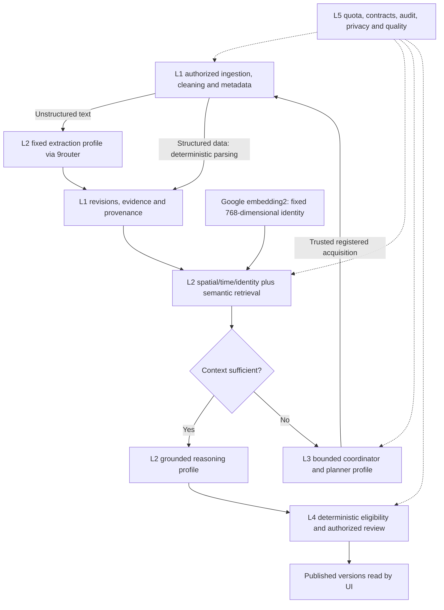

# AI pipeline model integration plan

Status: Team 12's local testing direction, updated 12 October 2026. Google Gemini Embedding 2 and the user's weekly curated Chinese preview model supersede the earlier Cloudflare candidates for local tests. Model/API/gateway compatibility is untested. No inference, model download, credential, router/Tailscale setting, binding or hosted service was changed.

## Model roles

| Capability | Selected testing direction | Contract and bounds |
| --- | --- | --- |
| Embedding | Google AI Studio / Gemini API `gemini-embedding-2`, routed through the user's 9router | Start with 768 dimensions/cosine and one input per request. Stable model/dimension/prefix/index identity for chunks and queries. No cross-model fallback or mixing vector spaces. |
| Classification/extraction | User-curated Chinese preview alias, user-reported minimum 128k context | Distinct short task profiles. Extract only supported category/tags/time/scope/evidence fields; claims belong to reasoning. Exact Unicode source spans, application schema validation and explicit unknowns remain required. |
| Grounded reasoning | Same curated model, separate profile | L2 retrieves evidence first, preserves contrary evidence/time/source status and invokes reasoning only on sufficient context. Output is a proposal or abstention, with no publication authority. |
| Investigation plan selection | Same curated model, separate planner profile | Only on insufficient L2 context. Suggest one trusted-menu action or abstention; L3 validates, reserves budget and dispatches registered tools. New acquisitions return through L1/L2. |

Two model families are enough for this test setup. The Chinese model is a rotating selection, not a permanently chosen brand. The user's unmetered access and 128k floor are recorded as supplied facts; provider throughput, output reliability, exact context limits and version availability are not independently measured. No additional classifier, reranker, fine-tuning or vision model is required for the current text pipeline. Structured preview JSON and map clustering continue through deterministic code.

## Quotas and test capacity

The user copied these values from their Free project's AI Studio rate-limit view. Public documentation now directs readers to signed-in project limits; these are not claimed as universal defaults or a reading from this agent's account.

| Embedding 2 limit | User-reported allowance | Proposed application allocation |
| --- | --- | --- |
| Requests/minute | 100 RPM | At most 80 RPM, shared across indexing, queries and retries |
| Input tokens/minute | 30,000 TPM | At most 24,000 TPM; reserve conservatively when exact usage is unavailable |
| Requests/day | 1,000 RPD | At most 800 RPD, minus other traffic using the same project |

The 80% allocation is a proposed margin, not implemented enforcement. Google quotas are project-wide, not per API key; all same-project router connections must share accounting. Daily allowance resets at midnight Pacific time. Stop/defer on exhaustion or 429, use bounded backoff, cache only exact permitted chunk/model/prefix identities, and never select a paid fallback or upgrade billing.

Illustrative single-input calls averaging 500 input tokens, including prefixes: `min(100, 30000 / 500) = 60` requests/minute at the provider ceiling; the proposed margin allows 48/minute. Daily 1,000 calls cover both ingestion and queries. For example, 600 document-chunk calls plus 100 query calls total 700, leaving 100 within the application's proposed 800-call allocation for retries/other test work. This is arithmetic, not a throughput or quota-consumption benchmark. Actual tokenization, other project traffic and provider latency still matter. Do not assume a multi-item HTTP batch counts as one unit of upstream quota.

## Existing contract fit

- Gemini Embedding 2 defaults to 3,072 dimensions; request 768 explicitly. Current L1 persistence accepts at most 2,048 while L2 accepts 8,192, so default output fails the tighter boundary. No validator/schema change is needed for 768.
- Google documents an 8,192-token embedding input limit. Keep inputs bounded below that, including the task prefix, without silently clipping source spans. Current character limits are not token limits; token budgeting needs a reviewed adapter/chunking policy.
- Keep embedding identity/model version/dimension/distance/index version together. Re-embed into a separate accepted identity/index when changing the embedding model or representation. Changing only the curated reasoning LLM does not require re-embedding the corpus.
- Current `embed` requests are evidence-chunk-bound; retrieval accepts an already-computed query vector. Arbitrary free-text query embedding needs a separately typed private port before integration. Never invent report/chunk lineage to send a user query through the evidence adapter. The query-call counts above are a future workload example, not an implemented query service.
- There is no explicit prefix field in `EmbeddingIdentity`. Before adding a fixed retrieval prefix, define a versioned private embedding profile with compatible document/query formatting and bind its version into `vectorIndexVersion`. Preserve the raw chunk hash/source offsets; record the actual formatted provider-input hash in private test/run metadata. Prefix changes require a new profile/index, not silent reuse.
- A 128k model capacity does not enlarge our application budget. L2 currently rejects reported input+output usage over 12,000 tokens per LLM call; L3 preserves its 5 tool/4 reasoning turn/60 active second/12,000-token investigation limits. Later adapters must enforce request-side reservations as well as validate returned usage. No full-history prompt or budget increase is authorized here.
- Resolve and record the underlying model/provider, curation epoch, prompt version and capability set per evaluation/run. Pin a route for an investigation; if unavailable, pause that case rather than silently changing model. A changed weekly selection needs fresh synthetic contract and held-out Bahasa/grounding checks. Do not claim reproducible weights from an unversioned provider alias.
- Persisted schema-2.0 proposal model runs and planner metadata do not currently store provider plus curation epoch. A private per-run/evaluation manifest must bind trace/case/run identity to resolved provider/model/epoch/profile/prompt versions, including planner calls; a bounded version-string convention can reference that manifest. This manifest is an implementation gate, not an existing database field or permission to alter public/schema-2.0 contracts.

## 9router boundary and private test path

Public upstream source was inspected read-only; the user's installed version is unknown. The current Gemini adapter maps OpenAI-shaped `dimensions` to native `outputDimensionality` and returns one vector per input item. Its documentation still describes dimension control as OpenAI-v3-only, so installed behavior must be probed rather than inferred from that table. The same adapter normalizes embedding token usage to zero; this is not proof of zero consumption. An application adapter needs conservative reservation/accounting and must not present synthetic zero usage as measured upstream tokens.

The existing embedding result has no token-usage field; quota accounting needs separate trusted transport telemetry/reservations and an explicit tokenizer/upper-bound policy. Unknown chat/planner usage must consume the conservative L3 reservation or fail closed, never count as zero. Do not relabel estimated usage as provider-measured usage.

Recommended local path: browser → local WSL backend → authenticated 9router over the user's private tailnet → Google embedding / curated Chinese inference. Backend credentials stay outside browser/Git. Tailscale Serve is tailnet-private; Funnel publishes a service. No Funnel, cloud bridge or network setting is configured by this plan. The later hosted Cloudflare-to-private-router path needs a separate connectivity decision and test.

For evidence-bearing calls, disable gateway prompt injection/token-saving/compression and pin the route. Upstream documents `X-9Router-Token-Saver: off` for chat requests. Verify your version preserves full evidence, contrary reports, exact Unicode and schema instructions. Bound/account router retries and fallback attempts, not only application HTTP calls. No fallback to another embedding model, paid route or unapproved provider. Verify cancellation, deadlines, usage/identity reporting and safe error mapping before L3 composition.

## Five-layer flow

This is a planned connection, not a configured runtime. Responsible AI/source provenance applies across every layer. Free-tier Google pricing marks submitted data as used to improve products; use synthetic/minimized permitted text for tests, and retain existing source-transfer/retention gates. Moderator demo remains read-only, and model output cannot bypass L4.

## Readiness and remaining verification

Enough model coverage and reported embedding capacity for a bounded local integration prototype. Remaining inputs are a backend-reachable 9router base URL, installed version, backend-only credential setup, and discoverable embedding/curated aliases. Do not send keys in chat. Before enabling provider calls: mock the adapter transport/schema/dimension/identity/timeout/quota paths; then authorize a small synthetic-only smoke within configured limits. No stress test, source acquisition or real-data transfer is part of this documentation work. Real case quality remains dependent on EVAL-01 rights and Perry/Jesaya's independent labels.

Earlier BGE-M3/Qwen3/Llama-FP8 Cloudflare candidates remain research history in Git and REFERENCES.md; they are not the active local-test choice or an automatic fallback. See [ADR-054](decisions/ADR-054-private-model-gateway-testing.md) and [the local reference register](../REFERENCES.md).
