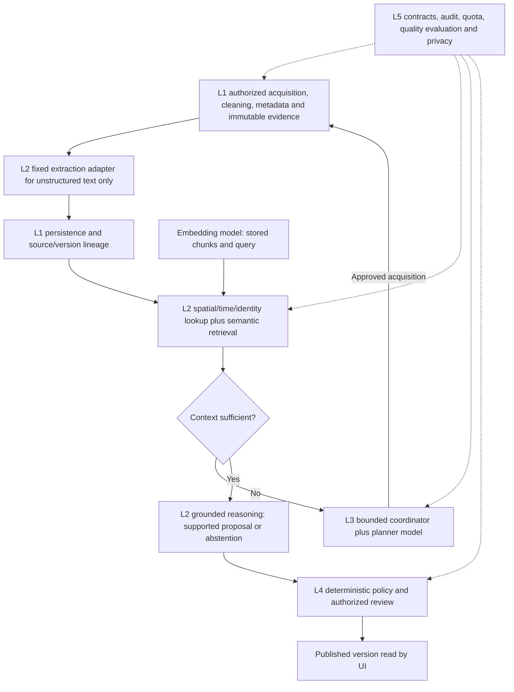

# AI pipeline model integration plan

Status: proposed candidates, 12 October 2026. This is model advice requested alongside UI-04 clustering, not acceptance or activation of a real provider. No inference, model download, binding, credential, paid API, source transfer or hosted configuration was performed. Local typed capability adapters and synthetic compositions exist; the four-source map preview remains deterministic L1/L4 and does not call them.

## Minimum model set

Two distinct models are enough for an initial RAG prototype. Keep classification, extraction, embedding, reasoning and investigation planning as separate typed capabilities even when a single LLM supplies several capabilities. No fine-tuning or independently trained classifier is needed initially.

| Capability | Initial candidate | Purpose and bounds |
| --- | --- | --- |
| Embedding | Cloudflare `@cf/baai/bge-m3` | Multilingual semantic context lookup and duplicate-candidate discovery. Proposed dense vector dimension1024/cosine, checked against actual provider output before acceptance. Similarity does not establish identical incidents, independent corroboration or truth. |
| Classification and extraction | Cloudflare `@cf/qwen/qwen3-30b-a3b-fp8`, short task-specific profiles | Categorize unstructured reports and extract time/place/entities/claims with exact source spans. Use distinct prompts/contracts and small input/output ceilings; return unresolved fields instead of invented facts. Structured OSM/PetaBencana/USGS/weather JSON continues through deterministic adapters without LLM extraction. |
| Reasoning and synthesis | Same Qwen3 candidate, separate grounded reasoning profile | Consume pre-retrieved evidence, preserve conflicts and source status, propose supported claims or abstain. No autonomous retrieval inside this adapter. |
| L3 plan selection | Same Qwen3 candidate, distinct planner adapter | Suggest one allowlisted action or abstention only after L2 context is insufficient. Existing coordinator enforces5 tools/4 turns/60 active seconds/12,000 tokens with failed attempts/resumes counted. No direct publication or unrestricted network tools. |

This minimum shares weights/provider while separating contracts and budgets; it does not claim the larger reasoning model meets a low-latency extraction target. If measured latency/quota/quality warrants a split, evaluate **`@cf/meta/llama-3.1-8b-instruct-fp8`** for the short classification/extraction path while retaining Qwen3 for complex reasoning/planning. That yields three model families including embeddings. Model size alone does not prove latency or Bahasa Indonesia accuracy.

The older canonical `llama-3.1-8b-instruct-fast` URL redirected to an unavailable-model catalog during this review, despite an older changelog describing fast variants as active. It is not the pinned candidate here. Recheck the exact canonical model ID and API access before activation; cached search results and playground presence are not runtime acceptance.

An optional reranker can be evaluated later if held-out retrieval tests show a need; it is not required for the MVP. OCR/vision, speech, translation, predictive-crime models, fine-tuning and separate "fact-checker agents" are outside this phase. Repeating the same LLM judgment is not independent verification.

## Five-layer flow and deterministic components

Source scheduling, schema validation, hashing/deterministic duplicates, geospatial indexing, map clustering, source-time freshness, budgets, authorization, audit and publication rules require no AI model. PetaBencana non-commercial transient preview permissions do not automatically authorize durable retention or transfer to a model. No new source/retention scope is cleared by this plan.

## Adapter and storage fit

Existing `ModelAdapterConfiguration` has independent classification/extraction/embedding/reasoning identities. `UntrustedModelProvider` returns unknown values, and validation rejects malformed output. The planner has a separate untrusted action-proposal boundary. A Cloudflare provider adapter still needs explicit request/response mapping, deadlines, cancellation/usage reporting, safe error handling, refusal/quota behavior and synthetic transport tests. Function-calling support is not automatic compatibility with Waspada schemas.

The database uses dimension-checked `vector` values with model/run/version metadata, not a fixed1536-column definition. Pin provider/model version, vector dimension, distance metric and index version together; never compare unrelated models or silently mix dimensions. Query and evidence vectors use the same accepted identity. An ANN index and hosted PostGIS/pgvector behavior remain a separate measured decision. Accepting BGE-M3 does not grant every optional sparse/multivector provider feature.

The current L1 embedding persistence boundary accepts at most 2,048 dimensions, while the L2 adapter permits up to 8,192. An end-to-end candidate must satisfy the tighter L1 limit; BGE-M3's proposed 1,024 dimensions fit both. Larger embeddings need a separately reviewed cross-layer contract change, not just a new model ID. No schema or validator is changed by this plan.

## Free-tier and activation gates

Official Cloudflare pricing, checked12October, provides a shared10,000 Neurons/day free allocation; account/model access and real consumption are untested. The listed BGE-M3/Qwen3/Llama-FP8 candidates are not in that page's explicitly paid-method-only model list, which is not a guarantee of account eligibility or workload fit. Use local token/turn/request caps, cache bounded permitted results, stop on quota exhaustion and show AI unavailable; no paid fallback or automatic upgrade.

Before real integration: choose an account/access method without putting secrets in Git/chat; verify model IDs and schemas with a separately authorized bounded probe; clear each source's model-transfer/retention scope; enforce application schemas and grounding rules; evaluate Bahasa extraction, retrieval and conflicting evidence using the EVAL-01 casebook. Perry and Jesaya's independent labels remain necessary for quality claims. Moderator publication stays read-only in the current demo; model acceptance does not authorize authenticated write routes or remove human publication review.

## Sources checked

- [Cloudflare BGE-M3](https://developers.cloudflare.com/workers-ai/models/bge-m3/) and [BAAI original model card](https://huggingface.co/BAAI/bge-m3): multilingual embeddings and the original dense1024-dimensional representation. The original model card and hosted provider advertise different context limits; the integration must use conservative chunk bounds and validate the actual hosted response.
- [Cloudflare Qwen3-30B-A3B-FP8](https://developers.cloudflare.com/workers-ai/models/qwen3-30b-a3b-fp8/): text generation, reasoning, function calling and provider response-format options.
- [Cloudflare Llama3.1-8B-FP8](https://developers.cloudflare.com/workers-ai/models/llama-3.1-8b-instruct-fp8/): optional separate smaller text-generation candidate.
- [Workers AI pricing](https://developers.cloudflare.com/workers-ai/platform/pricing/), updated9October2026: shared daily allocation and models requiring paid billing. Quotas are published limits, not project measurements.

See [REFERENCES.md](../REFERENCES.md) for the local source record. This plan does not change implementation contracts or provider configuration.
