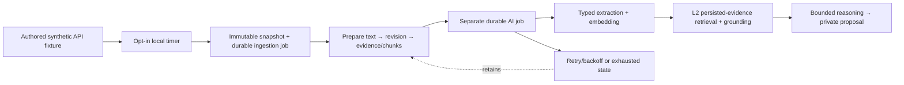

# Local synthetic polling → private proposals

Local synthetic CLI and app integration accepted, 12 October 2026. Tasks: [JOB-01-LOCAL-PRIVATE-PIPELINE](assignments/JOB-01-LOCAL-PRIVATE-PIPELINE.md) and [JOB-01-LOCAL-APP-INTEGRATION](assignments/JOB-01-LOCAL-APP-INTEGRATION.md); designs: [ADR-055](decisions/ADR-055-local-synthetic-polling-private-proposals.md) and [ADR-056](decisions/ADR-056-local-pipeline-app-integration.md). Parent JOB-01/RAG-01 remain in progress.

This Node-only tool reads one team-authored JSON API fixture. It does not poll a real website. The collection loop detects stable report IDs and changes to title, text, publication time or observation time. It atomically stores each immutable version and its ingestion job in disposable file-backed PGlite. Versions preserve first-capture time and superseding revision identity; unchanged polls do not schedule new work. A→B→A produces three versions. Feed removal is not a retraction or proof of resolution; out-of-order issuer revisions are not established by this authored fixture.



Models run outside SQL transactions. Each successful stage records a validated receipt and canonical writes together under the current lease; retries read those receipts first. The tool can repeat a provider call if it crashes before recording the result, so this is not exactly-once inference. Timeouts and invalid output leave closed failure codes with up to five attempts, 30/60/120/120-second backoff, then a terminal job. Evidence remains available. Terminal jobs are retained for investigation; there is no automatic reset or publication action.

All revisions remain unreviewed. The one authored origin has unknown independence; retrieval of that exact synthetic candidate proves composition only. An insufficient context stops before reasoning/L3. L4 publication, moderator mutation and public event routes are disconnected. The tool does not change Cloudflare, Neon, real source access, scheduled Worker bindings or the map UI.

Retrieval currently scans at most16 global evidence rows and returns at most8 hybrid matches before selecting the exact candidate. Its preview is limited to2048 code points; selected spans are then rehydrated exactly. Any scan/result truncation, omitted invalid span or missing support stops as `context_insufficient` and can exhaust retries as history grows. This small synthetic proof does not establish scalable historical retrieval. Collection/L1 continue retaining reports during that stop. A terminal L1 version also leaves later versions of the same stable report retained but blocked by the canonical supersedes dependency; other report IDs continue. There is no automatic repair/reset operation in this slice.

## Startup in WSL Ubuntu-26.04

Use the installed dependencies: Node24.21.0/npm11.19.0, tsx4.23.15, PGlite0.5.8, postgis0.2.8 and pgvector0.0.9. No new package or database server is needed.

```sh
export PATH=/home/perry/.nvm/versions/node/v24.21.0/bin:/usr/local/bin:/usr/bin:/bin
cd /mnt/d/Projects/RPL

# Disabled by default: no database or model call.
npm run pipeline:local

# One bounded mock cycle; same state can be reopened after process restart.
npm run pipeline:local -- --enable --once --state demo-1

# Automatic local polling, finite run of 12 polls, every five seconds.
npm run pipeline:local -- --enable --watch --interval-ms 5000 --max-polls 12 --state demo-1

# Counts only; no source read or model invocation.
npm run pipeline:local -- --status --state demo-1

npm run pipeline:test
```

`pipeline:test` discovers all owned top-level literal cases and runs each in a fresh Node process. An initial combined run hit a native Node24 V8/WASM allocation assertion while repeatedly opening PGlite in one process; it was recorded as a failure. The isolated rerun passed27/27 with no automatic retries. Unsupported test declarations, child crashes, nonzero exits and interruption fail the runner. Use the registered command for aggregate verification.

To simulate a change during mock polling, edit the authored `tools/local-pipeline/fixtures/feed.json` body under the same report ID. That fixture is explicitly synthetic and contains no inferred geometry. The CLI accepts no network feed URL. State lives under ignored `.codex-build/local-pipeline/<state>`; keep it private and disposable. Each state is pinned to a synthetic namespace and model profile. Stop the process before removing its selected state directory; do not point this tool at an existing application database.

Create fresh disposable state if experimenting with an earlier unreviewed bootstrap draft. This local bootstrap is not a migration/repair interface for legacy application data. It refuses an existing unowned application schema and a different synthetic/model profile before applying canonical migrations.

Use one process per state directory. Stop a watch run before opening the same state for status or another cycle. The tests prove lease behavior within one local PGlite instance and sequential process restarts; they do not prove independent PostgreSQL sessions, simultaneous file-backed PGlite processes or hosted Neon concurrency.

## Inspect the pipeline from the development app

The local app integration uses one Node service on127.0.0.1:8788 to own its PGlite state and serve a read-only projection. Vite proxies only `/__local/pipeline`. The app's **Pipeline lokal** tab (`#pipeline-lokal`) requires a development build and confirmed demo mode; the route and its code are removed from the production build. Public event APIs and the source map remain separate.

```sh
# Start web, existing Worker and a finite60-poll mock pipeline together (ports must be free).
npm run dev:pipeline

# If web/Worker already run from this checkout, start only the local service:
npm run pipeline:serve -- --enable --watch --state app-demo --interval-ms 5000 --max-polls 60

# After stopping its previous owner: read stored mock state without collecting/processing.
npm run pipeline:serve -- --enable --state app-demo

# Safe default: disabled, no port/database/model access.
npm run pipeline:serve
```

Open `http://127.0.0.1:5173/#pipeline-lokal`. The view reads actual stored report versions, separate issuer-publication/observation/capture times, L1/AI job states, retry availability, stage progress, private claims and supporting/contrary source spans. Technical IDs/hashes/ranges remain available in native disclosures. Refresh is manual and cannot start models, acquire sources, approve, publish or reset jobs. A proposal's current stored `proposedAt` is capture-anchored for replay; the UI labels that reference explicitly, not as inference-completion time.

Projection reads run in one repeatable-read, read-only transaction. The service validates exact synthetic source/namespace ownership, snapshot/canonical text hashes and Unicode lineage, including evidence outside the displayed versions. It returns newest20 versions with explicit truncation, bounded normalized private claim/evidence fields and a512KiB cap; it never returns arbitrary record JSON, model output/error text, credentials, lease tokens or vectors. Host/Origin/fetch-site checks deny cross-site requests, queries and mutations, with no permissive CORS. These local controls are not hosted moderator authentication. A failed or partial model job remains visibly private; schema/reference validation does not establish factual support or source independence.

Finite mock polling finishes while the read-only service remains available. Stop it with Ctrl+C before another process opens the same state. Real gateway state can be inspected only after its CLI attempt stops, using the same profile/curation tag/output-policy flag; the service cannot schedule a real model cycle. This integration does not activate real sources, L3 tool dispatch, public publication, hosted resources or the paused freshness runtime.

## Separately opt-in real gateway probe

Routine checks use model doubles and do not read gateway credentials. The following command deliberately opts into the configured private gateway. It requires `NINEROUTER_URL`, `NINEROUTER_KEY`, and a stable nonsecret `NINEROUTER_CURATION_EPOCH` in ignored `.env.local`. Never paste those secrets into documentation or chat.

```sh
node --env-file=.env.local --import tsx tools/local-pipeline/run-local-pipeline.ts --enable --once --real-ai

# Explicitly omit extraction output-limit fields; other calls/deadlines remain bounded.
node --env-file=.env.local --import tsx tools/local-pipeline/run-local-pipeline.ts --enable --once --real-ai --omit-extraction-output-limits
```

This creates fresh isolated state, processes at most one authored report/AI attempt, and reserves at most three adapter HTTP attempts: extraction, embedding and reasoning. It does not run discovery, classification, planner actions, autonomous acquisition or automatic HTTP retries. Each provider request is limited to25seconds and each local model wait to26seconds. A failed stage leaves the private job in `retry` with backoff, or `terminal` after exhausted attempts; the command does not wait and retry. Requested routes remain `Waspada-Jakarta` and `gemini/gemini-embedding-2-preview`; a curation epoch tags the configuration and does not pin the underlying weights.

The command prints its generated `real-<uuid>` state name. For a separately opt-in retry after backoff, add `--state real-<uuid>` to the same real command, keeping the original curation epoch and output-policy flag. That resumes only the stored snapshot and at most one AI attempt; it does not collect the edited fixture or drain other jobs. To inspect counts without model calls, use `--status --real-ai --state real-<uuid>` instead of `--enable --once`. Reopening under a different model profile/output policy fails closed. A crash with a still-active lease waits for lease expiry and recovery backoff before another attempt.

For read-only app inspection of an existing real state after stopping its owner:

```sh
# Replace the quoted placeholder with the exact generated state name before running.
node --env-file=.env.local --import tsx tools/local-pipeline/run-local-server.ts --enable --real-ai --omit-extraction-output-limits --state 'real-<uuid>'
```

Use the same epoch and omit the output-policy flag if the state was created with default extraction limits. The server requires existing real state and profile identity, opens it read-only and makes no provider call. Omission changes only extraction's sent generation controls and4,096 output-allowance check; the12,000 total-token application validity remains. It does not disable the25/26-second transport/processor deadlines or enable a real scheduler.

One bounded gateway pipeline probe ran on 12 October 2026, 13:04:22.695–13:05:46.445 UTC. It attempted extraction once with only `model`, `messages`, and `stream`; the transport failed without an accepted HTTP response. The private AI job remained `retry`, attempt 1, with closed code `model_failed` and no stage receipts or proposal. One snapshot and its completed L1 ingestion remained intact; event versions, publication decisions and outbox rows were all zero. The 83.749-second total includes database startup and reopening, so it is not extraction latency. The safe receipt does not distinguish a deadline from another transport cause. There was no automatic retry or embedding/reasoning call.

The probe used process-only tag `app-integration-test-20261012-v1` because an operator curation epoch was not configured. It does not establish a pinned upstream model. Root then inspected that exact state through the read-only service and browser; three scenario groups passed, with unchanged jobs/evidence after manual refresh and no public data. The mock state was restored for normal local development. See [gateway testing](PRIVATE_AI_GATEWAY_TESTING.md) for the ignored receipt identity and cumulative attempts.

To inspect this particular failed probe, first stop the mock service on port 8788 and supply the same process-only tag explicitly. This reads existing state and cannot retry its model job:

```sh
NINEROUTER_CURATION_EPOCH=app-integration-test-20261012-v1 node --env-file=.env.local --import tsx tools/local-pipeline/run-local-server.ts --enable --real-ai --omit-extraction-output-limits --state real-bf6a5d3c-c117-4c5b-bff4-a15f629090c6
```

Prior extraction timeouts at 25 and 45 seconds remain open; this probe did not resolve them. Real sources require documented access, reuse/retention and model-transfer terms. Human-reviewed quality evaluation, source authenticity, conflict resolution, spatial retrieval quality, hosted concurrency and the complete live pipeline remain separate gates.

## Actual acceptance evidence

For the app integration, root's final WSL checks passed: isolated `npm run pipeline:test` 43/43, web 133/133, Worker 518/518, evaluation/AI 41/41, workspace/tool typechecks, Vite build, Wrangler dry-run and local smoke. Nine mock browser groups and three actual gateway-failure inspection groups passed, with desktop/mobile screenshots inspected and native disclosures tested with the keyboard. Production output excludes the local route/endpoint/module. The final service restart processed two unchanged mock polls and retained one proposal, with no duplicate work. A broader `npm test` was deliberately interrupted after web/Worker and 20 completed DB files; it is not reported as a full pass. A peer's aggregated pipeline-file check hit the known native WASM failure; the registered final per-case runner passed without automatic retries.

The earlier CLI-only baseline checks below are preserved as historical evidence; the new real pipeline attempt is recorded above and did not pass its AI stage.

In WSL Ubuntu-26.04: new pipeline27/27; existing web126/126, Worker516/516, DB45/45 test files and evaluation/AI36/36 passed. Full workspace/tool typecheck, Vite build, Wrangler dry-run and local UI/API smoke passed. The original combined `npm test` stopped at the native WASM crash; the unchanged regression suites were not repeated after isolating the new tool suite. The final isolated suite and build/smoke were run separately; this is not a claim that the original command passed.

Actual disabled CLI, finite two-poll mock watch, reopen/unchanged one-cycle and count-only status passed. Reopen retained exactly one snapshot, one completed ingestion job, one completed AI job and one private proposal. Tests cover A→B→A provenance, immutable snapshots, unrelated-job isolation, changed queued content, contradictory evidence/unknowns, pending AI collection, timeout/invalid-output retry, exhausted states, lease fencing, raw-error/credential exclusion and file-backed receipt replay after lost completion acknowledgement. Publication-related SQL tables remain empty on this path. Detailed commits, independent review and fixes are in [the delivery log](DELIVERY_LOG.md).
