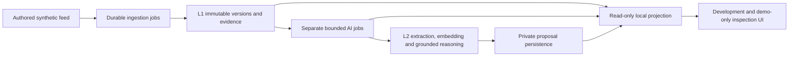

# ADR-056 — Local pipeline integration into the development app

Status: accepted local implementation, 12 October 2026. Owner: Team 12. Parent JOB-01/RAG-01 remain in progress.

The earlier pipeline stored durable local evidence/proposals without an app inspection view. The accepted integration adds a separate Node loopback service that owns one disposable synthetic PGlite instance and exposes only a bounded read-only local DTO. Vite proxies that path during development. A demo/development-only view shows versioned source evidence, job states and private model proposals. Public Worker routes, map geometry, Layer4 publication and hosted schemas stay unchanged. This is a local system integration, not a production private moderation/authentication API.

The service can run finite mock polling concurrently with reads; real gateway state is inspection-only. Real model processing remains an explicit once/resume CLI command, at most three provider requests and existing25/26-second bounds. The diagnostic's extraction output-limit omission may be explicitly selected and becomes part of the state profile identity; it does not disable production deadlines or12,000-token application validation. Do not reinterpret one6.499-second diagnostic as proof of model quality or permanent upstream reliability.

Loopback binding, fixed Host/Origin validation, no permissive CORS, closed DTO validation, synthetic namespace/source ownership and no-store responses protect the local surface. They do not replace hosted authentication. Source/claim text is escaped data; raw errors, secrets, URLs, vectors, arbitrary JSON and lease tokens are excluded. Invalid stored lineage fails closed. Latest20 snapshot versions have an explicit truncation flag; database totals are distinguished from visible rows.

No live source is activated until access, retention and model-transfer terms are documented. No public event or moderator mutation occurs. Hosted Cloudflare/Neon transport, access controls, source quality, scalable retrieval, L3 dispatch and publication are later tasks under existing stable backlog IDs.

Projection uses one repeatable-read, read-only transaction and validates canonical stage prefixes; completed AI jobs require all five receipts. Startup signals cancel before serving/scheduling and cleanup closes acquired resources. Native disclosures keep identifiers available without overwhelming mobile evidence reading. The current proposal timestamp is capture-anchored for replay, so the UI states its meaning explicitly. Normalized private claim tables are projected; this is not a complete canonical-JSON proposal validator or publication gate.

Independent review and WSL integrated checks passed: isolated pipeline 43/43, web 133/133, Worker 518/518, evaluation/AI 41/41, typecheck/build/dry-run/smoke, nine mock browser groups and three real-state groups. The actual gateway probe failed at extraction transport after one attempt; L1 remained stored and AI was `retry`, with no proposal/public rows. Its closed receipt cannot identify the cause or demonstrate extraction reliability. [Actual evidence, commands and limits](../LOCAL_PRIVATE_PIPELINE.md).
