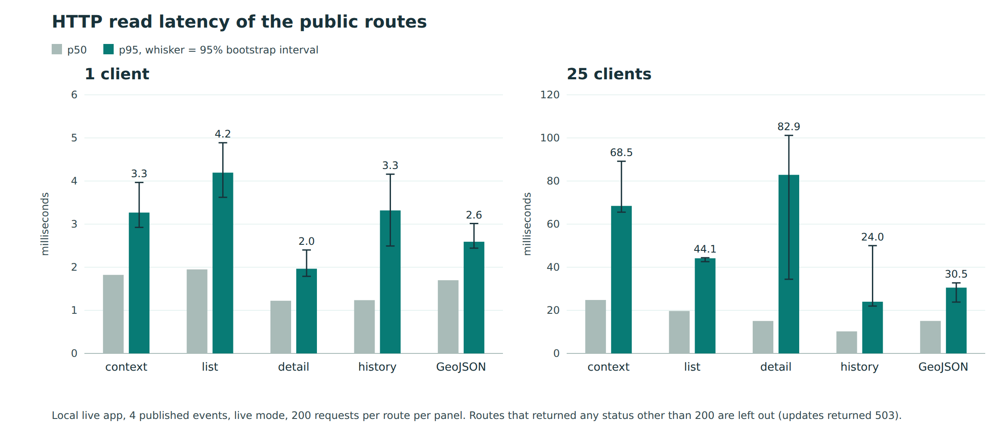

# Performance results

Status: first HTTP run, 13 November 2026. This is a baseline. No target has been set (SDP section 4).

## Method

- Target: `http://127.0.0.1:8787`, dataset_mode `live`, 4 published event(s) in the list at run time. The dataset is small, so these results do not show how latency grows with more events.
- Calls: read-only GET requests over HTTP. Each sample includes reading the full response body.
- Samples: 20 warm-up requests per route, then 200 measured requests per route at concurrency 1, 10, 25.
- Statistics: nearest-rank percentiles, as in `tools/evaluation/model-benchmark.ts`. The 95% interval for p95 is a seeded bootstrap with 10,000 resamples (`tools/perf/stats.ts`). Throughput is requests divided by wall time.
- Client: Node v24.21.0, on the WSL host, same machine as the server.

## Results (milliseconds)

| Route | Concurrency | n | Status | Mean | SD | p50 | p95 | p95 95% CI | p99 | Max | Requests/s |
| --- | ---: | ---: | --- | ---: | ---: | ---: | ---: | --- | ---: | ---: | ---: |
| `/api/v1/context` | 1 | 200 | 200 x200 | 3.31 | 15.86 | 1.82 | 3.27 | 2.92 to 3.97 | 8.10 | 221.03 | 300.77 |
| `/api/v1/context` | 10 | 200 | 200 x200 | 70.91 | 262.55 | 10.07 | 28.86 | 24.58 to 1211.09 | 1215.72 | 1227.86 | 140.55 |
| `/api/v1/context` | 25 | 200 | 200 x200 | 33.64 | 20.69 | 24.80 | 68.45 | 65.56 to 89.17 | 90.75 | 90.97 | 722.95 |
| `/api/v1/events` | 1 | 200 | 200 x200 | 2.39 | 2.83 | 1.95 | 4.19 | 3.62 to 4.89 | 6.95 | 30.11 | 402.69 |
| `/api/v1/events` | 10 | 200 | 200 x200 | 12.83 | 8.27 | 10.49 | 29.12 | 25.79 to 37.00 | 40.53 | 41.63 | 761.78 |
| `/api/v1/events` | 25 | 200 | 200 x200 | 23.08 | 10.69 | 19.70 | 44.15 | 42.59 to 44.40 | 60.14 | 63.64 | 1022.90 |
| `/api/v1/events/{id}` | 1 | 200 | 200 x200 | 1.31 | 0.37 | 1.22 | 1.97 | 1.79 to 2.40 | 2.55 | 2.67 | 735.14 |
| `/api/v1/events/{id}` | 10 | 200 | 200 x200 | 31.55 | 97.79 | 7.68 | 50.02 | 27.35 to 455.83 | 457.21 | 459.71 | 315.14 |
| `/api/v1/events/{id}` | 25 | 200 | 200 x200 | 21.65 | 21.98 | 15.06 | 82.87 | 34.42 to 101.17 | 113.22 | 113.24 | 1099.88 |
| `/api/v1/events/{id}/history` | 1 | 200 | 200 x200 | 1.78 | 2.60 | 1.24 | 3.32 | 2.49 to 4.16 | 10.15 | 30.30 | 556.16 |
| `/api/v1/events/{id}/history` | 10 | 200 | 200 x200 | 41.70 | 154.46 | 5.64 | 20.56 | 11.63 to 713.03 | 714.93 | 715.32 | 238.98 |
| `/api/v1/events/{id}/history` | 25 | 200 | 200 x200 | 14.16 | 13.00 | 10.23 | 23.99 | 21.98 to 50.02 | 84.91 | 106.72 | 1669.78 |
| `/api/v1/events.geojson` | 1 | 200 | 200 x200 | 1.86 | 1.03 | 1.70 | 2.59 | 2.44 to 3.01 | 4.29 | 13.62 | 526.22 |
| `/api/v1/events.geojson` | 10 | 200 | 200 x200 | 6.62 | 2.61 | 5.73 | 11.99 | 11.52 to 12.66 | 12.83 | 12.86 | 1478.92 |
| `/api/v1/events.geojson` | 25 | 200 | 200 x200 | 16.51 | 10.30 | 15.08 | 30.53 | 23.82 to 32.73 | 67.41 | 96.61 | 1363.60 |
| `/api/v1/updates` | 1 | 200 | 503 x200 | 1.14 | 0.26 | 1.07 | 1.65 | 1.51 to 1.80 | 2.07 | 2.44 | 868.45 |
| `/api/v1/updates` | 10 | 200 | 503 x200 | 6.17 | 2.65 | 5.39 | 10.91 | 10.18 to 12.13 | 12.90 | 14.89 | 1572.33 |
| `/api/v1/updates` | 25 | 200 | 503 x200 | 14.35 | 5.47 | 12.41 | 23.92 | 20.65 to 27.85 | 36.35 | 36.47 | 1643.41 |

## Figure

Figure: p50 and p95 by route at 1 and 25 clients, from the table above. Whiskers show the 95% bootstrap interval for p95. Rendered by `tools/perf/chart.ts`.
## Not in this run

- The web first load on desktop and phone (ST-P-03).
- Cold start (first request after a restart), and reads while polling and inference run (ST-P-04).
- Datasets of 50, 500 and 5,000 events. The live server holds only the events it has published, so a larger dataset needs more data loaded into it.
- Any route that does not return 200 is reported with its status in the table, and is not a successful read.
