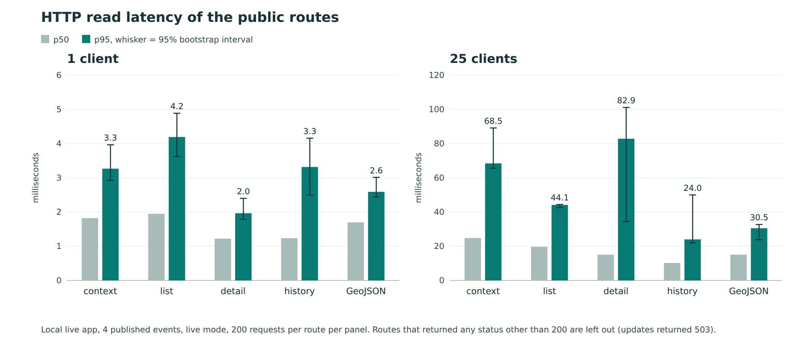

# Software Test Documentation (STD) — Waspada Jakarta

| Field | Value |
| --- | --- |
| **Project** | Waspada Jakarta — Live Civic Safety Intelligence Platform |
| **Course / Team** | Rekayasa Perangkat Lunak (RPL) — Team 12 |
| **Standards Followed** | IEEE Std 829-1998 (*Software Test Documentation*) consolidated per Braude & Bernstein, *Software Engineering: Modern Approaches* (Part VII, Ch. 25–28) |
| **Document Version** | 1.1 (Preliminary Human UAT + Complete Test Case Register) |
| **Status Date** | 20 November 2026 |
| **Codebase Baseline** | Verified CI baseline `a7ba558` (GitHub Actions run `44372632858`, 2,772/2,772 passing); current `main` head `5d4dc3c` (includes `PERF-01` and `TG-GAP-05` hardening commits pending full CI re-recording) |
| **Hosted Production URL** | `https://waspada-jakarta.waspada-worker.workers.dev` |

---

## Document History

| Version | Date | Author | Summary of Changes |
| --- | --- | --- | --- |
| 0.1 | 12 Nov 2026 | Team 12 | Initial unit test documentation (`DOKUMENTASI_UNIT_TESTING.md`) and baseline CI run (`cec9358`, 2,034 tests). |
| 0.2 | 13–18 Nov 2026 | Team 12 | Added integration, system, performance, and hosted production checks (`ST-H-01`–`ST-H-12`, CI run `44319579284`, 2,654 tests). |
| 0.3 | 19 Nov 2026 | Team 12 | Recorded `EXPLORE-18` fixes (`HOSTED-32`–`HOSTED-38`, `ST-H-13`–`ST-H-20`), `TEST-GAP-03`, and `POLISH-01`–`03` (CI run `44372632858`, 2,772 tests). |
| 1.0 | 20 Nov 2026 | Team 12 | Consolidated STD following IEEE Std 829-1998 & Braude; integrated preliminary Public Human UAT (5 of 18 planned respondents). |
| 1.1 | 20 Nov 2026 | Team 12 | Removed Client QA/UAT section (to be compiled separately); appended complete 165-row test case register (`test-cases.csv`) as Appendix C. |

---

## Table of Contents

1. [Chapter 1 — Introduction and Master Test Plan](#chapter-1--introduction-and-master-test-plan)
2. [Chapter 2 — Unit Testing](#chapter-2--unit-testing)
3. [Chapter 3 — Integration Testing](#chapter-3--integration-testing)
4. [Chapter 4 — System Testing](#chapter-4--system-testing)
5. [Chapter 5 — Acceptance Testing (UAT)](#chapter-5--acceptance-testing-uat)
6. [Chapter 6 — Test Incident Summary and Master Test Summary Report](#chapter-6--test-incident-summary-and-master-test-summary-report)
7. [Appendix A — Requirements Traceability Matrix](#appendix-a--requirements-traceability-matrix)
8. [Appendix B — Repository Evidence Index](#appendix-b--repository-evidence-index)
9. [Appendix C — Complete Test Case Register (165 Cases)](#appendix-c--complete-test-case-register-165-cases)

---

## Chapter 1 — Introduction and Master Test Plan

### 1.1 Purpose and Scope

This Software Test Documentation (STD) consolidates the test plan, test designs, representative test cases, execution logs, defect summaries, and acceptance results for **Waspada Jakarta** under **IEEE Std 829-1998** and **Braude (Chapters 25–28)**. Rather than duplicating all eight IEEE 829 templates across every sub-module, this document establishes a single master test plan in Chapter 1 and reports level-specific designs, cases, and results across Chapters 2–6. Detailed raw registers (`test-cases.csv`, 165 rows) and individual commit/defect trails (`DEFECTS.md`) are cross-referenced in Appendix B.

**In Scope:**
- Functional requirements `FR-02` to `FR-16` (`FR-01` was formally withdrawn on 13 November 2026; `FR-09` was narrowed to point geometry on 13/16 November 2026).
- Non-functional requirements `NFR-01` to `NFR-08` and user stories `US-01` to `US-03` from `SOFTWARE_DEVELOPMENT_PLAN.md` (SDP §2, §4, §10).
- Three execution targets: **local synthetic demo** (`DATASET_MODE=demo`), **local live mode** (`npm run serve:live`), and **hosted production** on Cloudflare Workers Free + Neon Free (`DATASET_MODE=live`).
- Four verification levels: Unit, Integration, System (functional, non-functional, browser, hosted), and Acceptance (preliminary public human UAT and supplementary automated walkthroughs).

**Out of Scope / Explicit Limitations:**
- Automated end-to-end tests calling the hosted production API (hosted verification is manual/scripted read-only or exploratory).
- Physical Android device/emulator testing (`apps/mobile` is verified locally via `flutter analyze` and unit tests only).
- Held-out adjudicated AI accuracy evaluation (requires ≥40 labelled reports across 12 cases with two independent reviewers and cleared source rights, which are not yet available).
- Full penetration testing and automated hosted database backup/restore drills (Neon Free holds the single hosted copy).

### 1.2 Test Items

| Test Item | Architectural Role | Primary Runner / Evidence |
| --- | --- | --- |
| `apps/worker` | Cloudflare Worker HTTP API (`/api/v1`), L1 ingestion/triage, L3 investigation, L4 publication gate & projections | Node test runner (`node:test` + `tsx`) |
| `apps/db` | PostgreSQL + PostGIS + pgvector schema (59+ migrations), repositories, SQL security & audit functions | Node test runner over in-process PGlite (one process per file) |
| `apps/intelligence` | Mastra interpretation/correlation workflow, Google AI Studio / NineRouter adapters, budget guards | Node test runner (`node:test` + `tsx`) |
| `apps/web` | React 19 + Vite + Three.js responsive map-first UI, incident details, preferences, moderator/admin workspace | Node test runner + Playwright Chromium walkthroughs |
| `apps/mobile` | Flutter public reader (Android) | `flutter test` (local evidence only; not in CI) |
| `tools/*` | Local private pipeline, synthetic accounts runtime, hosted ingest scripts, HTTP performance harness | `tsx --test`, GitHub Actions `ingest.yml` |

### 1.3 Testing Strategy and Box Types

Following Braude (Chapters 25–28), testing progresses bottom-up across four levels with distinct box types and verification goals:

| Level | Primary Executor | Box Type | Inputs & Isolation | Primary Evidence |
| --- | --- | --- | --- | --- |
| **Unit** | Component author | White-box & specification black-box | Deterministic in-memory fixtures, pure functions, no external network | 285 test files, CI log (`44372632858`), `DOKUMENTASI_UNIT_TESTING.md` |
| **Integration** | Team reviewer (non-author where possible) | Gray-box (layer boundaries, HTTP facade, freshness state machine) | In-process PGlite (PostGIS + pgvector), fake clocks/fetch, synthetic fixtures | 60 integration rows in `test-cases.csv`, `INTEGRATION-TEST.md` |
| **System** | Reviewer (separate from implementer) | Black-box (use cases, `FR`/`NFR`, viewports, hosted smoke) | Demo dataset, local live app (`serve:live`), hosted Cloudflare + Neon site | `SYSTEM-TEST.md`, `PERFORMANCE.md`, hosted checks `ST-H-01`–`ST-H-20` |
| **Acceptance (UAT)** | Public volunteers (human), plus supplementary Playwright agents | Black-box (real end-user tasks) | Hosted live site (`waspada-jakarta.waspada-worker.workers.dev`) & demo stack | Public UAT Form CSV (5/18 completed), `UAT.md` |

*Note on Coverage and Mutation Testing:* Per `TEST-PLAN.md` §3, code coverage percentages and mutation testing (Braude Ch. 25) are not instrumented in this project and are therefore not claimed.

### 1.4 Test Environment

| Component | Configuration |
| --- | --- |
| **Local Development Host** | WSL2 Ubuntu (Node.js v24.21.0, npm 11.19.0; lockfile `package-lock.json` authoritative). Local policy runs `npm run typecheck` and changed files individually; full suites execute on CI to avoid WSL memory crashes. |
| **CI Environment** | GitHub Actions `ubuntu-24.04`, Node.js `24.21.0` pinned (`.github/workflows/ci.yml`), running 9 stages: Typecheck, Database, Web, Worker, Intelligence, Pipeline, Accounts, Evaluation/AI, and Vite + Wrangler dry-run build. No browser or live network calls run in CI. |
| **Database Test Engine** | PGlite `0.5.8` with `@electric-sql/pglite-postgis` `0.2.8` and `@electric-sql/pglite-pgvector` `0.0.9`, spawned in an isolated child process per test file (`apps/db/test/run-db-tests.ts`). |
| **Hosted Production Target** | Cloudflare Workers Free (`DATASET_MODE=live`) + Neon Free PostgreSQL 17 (PostGIS + pgvector) via Cloudflare Hyperdrive (`HYPERDRIVE` cached for public GETs; `FRESH_HYPERDRIVE` / `AUTH_HYPERDRIVE` uncached for moderation, admin, auth, and writes). Scheduled ingest triggered every 30 min (`7,37 * * * *`) via GitHub Actions `ingest.yml`. |
| **Browser Testing** | Playwright Chromium (`^1.64.1`) for automated walkthroughs (`1440×900`, `390×844`) and participants' own Chrome/Firefox browsers for public human UAT. |

### 1.5 Roles, Responsibilities, and Independence Limitation

- **Author:** Implements modules and writes/runs unit and component tests.
- **Reviewer:** Verifies interfaces, requirements evidence, and system tests on components they did not author.
- **Orchestrator:** Maintains the master test plan, `test-cases.csv`, `DEFECTS.md`, and STD consolidation.
- **External Evaluators:** Public volunteers (target 18 participants; 5 collected to date) for real-user usability and acceptance testing.
- **Limitation:** Because Team 12 has three members, internal reviewer independence is partial; external public UAT mitigates this bias.

### 1.6 Pass/Fail, Entry, Suspension, and Stopping Criteria

- **Entry Criteria (Integration/System):** `npm run typecheck` passes, component unit tests pass, and all SQL migrations apply cleanly on PGlite.
- **Suspension Criteria:** CI infrastructure outage, out-of-memory failure, or PGlite WebAssembly runtime crash (e.g., `D-04`). Suspended runs are never counted as passes and must be re-run cleanly.
- **Pass/Fail Rule:** Automated tests pass only when `fail = 0` in a green CI run. Blocked (unmet precondition) and Pending (missing live data or uncollected human sample) rows are tracked separately and are not classified as defects.
- **Stopping / Release Criteria (SDP §10):** Zero failing CI suites on `main`; zero open High-severity release-blocking defects (unsupported publication, exposed PII, wrong active warning geometry, budget bypass, unauthorized moderation, or public outage); all untested items explicitly documented; and human usability target (NFR-03: ≥80% completing Task 1 within 60 s across phone and desktop) evidenced.

### 1.7 Schedule and Milestones

| Milestone / Phase | Date / Window | Status (20 Nov 2026) |
| --- | --- | --- |
| Unit & Local Integration Gate (`M2`–`M5`) | Weeks 3–10 (through 13 Nov 2026) | **Complete** (automated suites green) |
| Hosted Production Deployment & Smoke (`HOSTED-23`–`38`) | 17–19 Nov 2026 | **Complete** (`ST-H-01`–`ST-H-20`, CI `44372632858`) |
| Public Human UAT Collection (Target: 18 Testers) | Started 20 Nov 2026 | **In Progress — 5 of 18 collected (13 remaining)** |

---

## Chapter 2 — Unit Testing

### 2.1 Unit Testing Approach and Static Walkthrough

Unit testing follows a **layered, zero-network deterministic strategy** (`DOKUMENTASI_UNIT_TESTING.md` §1): external AI gateways and RSS feeds are replaced with deterministic in-memory adapters, and database repositories run against ephemeral PGlite instances bootstrapped from migrations. All TypeScript packages enforce `"strict": true` with ESM modules and guard clauses against null/empty boundary inputs.

During static code review and git-history inspection (`DOKUMENTASI_UNIT_TESTING.md` §2.a), two verified code defects with isolated `fix` commits were confirmed and corrected:
- **`D-01` (`66d8e94`):** Duplicate `/v1` suffix in `getNineRouterConfig()` (`apps/intelligence/src/providers/ninerouter-adapter.ts`) caused `/v1/v1/chat/completions` 404 errors; fixed by normalizing trailing slashes and stripping `/v1`.
- **`D-02` (`973f70a`):** Live RSS seeder (`tools/serve-live-pipeline.ts`) inserted `source_kind = 'media'`, violating the SQL `CHECK` constraint on `waspada.source_registry`; fixed to `'newsroom'`.

### 2.2 Representative Unit Test Cases

The full suite spans 285 test files across all workspaces (`CI-VISIBILITY.md`). Table 2.1 highlights representative white-box and specification-based unit test cases verifying core domain logic and safety invariants:

| Test ID | Module / File | Input & Boundary Conditions | Expected Result | Status |
| --- | --- | --- | --- | --- |
| **TC-01** | `apps/worker/test/deterministic-relevance.test.ts` (9 tests) | Jakarta flood news, political non-incident news, negated casualty text, `Kec.`/`Kel.` prefixes, canonical gazetteer (44 districts, 267 kelurahan) | Relevant flood passes; political/negated/forecast items downgraded; longest-match normalization deterministic & bounded | **Pass** |
| **TC-02** | `apps/web/test/embedding-pca.test.ts` (5 tests) | $N \times 768$ Gemini embedding matrices; degenerate cases ($N=0, 1, 2$ identical vectors); two synthetic clusters | Centered 3D projection in $[-1, 1]$, zero division-by-zero / `NaN` on boundary inputs, distinct cluster separation | **Pass** |
| **TC-03** | `apps/worker/test/correlated-proposal-engine.test.ts` | Water depth `50 cm` vs `90 cm` ($\Delta \ge 30\text{ cm}$), `40 cm` vs `50 cm` ($\Delta < 30\text{ cm}$), contradictory casualties & fire status | Flags `has_discrepancy = true` when $\Delta \ge 30\text{ cm}$ or status/casualties conflict; `false` when $\Delta < 30\text{ cm}$ | **Pass** |
| **TC-04** | `apps/db/test/news-triage-decisions.test.ts` | Repeated triage records with identical `contentHash`; sequential attempts separated by 15 ms | Idempotent persistence (no duplicate rows); `readLatestAttemptForRevision` consistently returns the newest attempt | **Pass** |
| **UT-HOST-12** | `apps/web/test/event-time-day-precision.test.tsx` | Missing event times, date-only times, expired freshness across card/popup/detail | Unified Indonesian wording (*"Waktu kejadian tidak disebutkan"*, day-only precision, *"Lewat masa berlaku sumber"*) | **Pass** |
| **UT-HOST-13..21** | `apps/web/test/record-map-layout.test.tsx`, `hosted34-ui-copy.test.tsx`, `apps/intelligence/test/hosted35a-*.test.ts` | Web Mercator pin projection, Indonesian UI labels, word-boundary title truncation, grounded event-time checks | 0.00 km pin math, no leaked English/internal terms (`CRS84`, `record`), no fabricated timestamps | **Pass** |

### 2.3 Unit & Automated CI Execution Summary

In the verified green CI run **`44372632858`** (`main` at `a7ba558`, 19 November 2026), **all 9 CI stages passed with 2,772 passing tests/cases and 0 failures** (`TEST-SUMMARY.md` §3):

| CI Step | Suite Scope | Verified Count (Run `44372632858`) | Outcome |
| --- | --- | ---: | --- |
| 5 | TypeScript Typecheck (`npm run typecheck`) | — | **Pass** |
| 6 | Database (`apps/db`, 61 PGlite files) | 418 tests | **Pass (0 fail)** |
| 7 | Web Client (`apps/web`) | 482 tests | **Pass (0 fail)** |
| 8 | Worker API & Layers (`apps/worker`) | 1,407 tests | **Pass (0 fail)** |
| 9 | Intelligence & Mastra (`apps/intelligence`) | 233 tests | **Pass (0 fail)** |
| 10 | Local Private Pipeline (`tools/local-pipeline`) | 58 cases | **Pass (0 fail)** |
| 11 | Accounts & Hosted Ingest Tools (`tools/accounts`) | 100 tests | **Pass (0 fail)** |
| 12 | Evaluation & AI Tools (`tools/evaluation`, `tools/ai`) | 74 tests | **Pass (0 fail)** |
| 13 | Production Build (Vite + Wrangler dry-run) | — | **Pass** |
| **Total** | **All CI Automated Suites** | **2,772 tests & cases** | **Pass (2,772/2,772)** |

*Register Alignment:* All **34 of 34** unit-level rows in `docs/testing/test-cases.csv` record `actual_result = Pass`. Local-only Flutter evidence (`apps/mobile`) recorded 41 passing tests (15 Oct 2026) plus 22 passing model tests (`POLISH-02`, 19 Nov 2026), not executed in CI.

---

## Chapter 3 — Integration Testing

### 3.1 Bottom-Up Build Order

Integration testing follows Braude (Chapter 27) using bottom-up incremental builds aligned with Waspada Jakarta's five-layer architecture (`INTEGRATION-TEST.md` §2):

```
Build 1: L1 Data & Knowledge + PGlite (PostGIS, pgvector, 59+ migrations)
   ↓
Build 2: L2 Grounding, Embeddings & Retrieval (against persisted Build 1 evidence)
   ↓
Build 3: L3 Bounded Investigation Ledger + L4 Publication Gate, Accounts & Public Projections
   ↓
Build 4: Hosted Integration Hardening (Hyperdrive fresh/cached split, cron dispatch, backfill, attribution)
```

### 3.2 Consolidated Integration Build Verification

| Build | Register IDs (`test-cases.csv`) | Layers Crossed | Key Test Suites (Representative) | Verified Integration Behaviour | CI Status |
| --- | --- | --- | --- | --- | --- |
| **Build 1** (Data & Ingest) | `IT-B1-01`–`07`, `IT-REG-01`–`02` *(9 rows)* | L1 ↔ DB, Worker | `petabencana-ingest-pglite.test.ts` (`IT-B1-01`), `synthetic-source-poll-process-runtime.test.ts` (`IT-B1-02`/`05`), `gated-rss-revision-identity.test.ts` (`IT-B1-03`), `news-triage-rate-limit.test.ts` (`IT-B1-04`), `webhook-ingest-db.test.ts` (`IT-B1-06`) | PetaBencana & RSS revisions/chunks persist idempotently in PGlite; denied rights trigger zero fetches/jobs; Stage B rate-limit cooldown preserves retry budgets; malformed webhook batches roll back cleanly (0 rows). | **Pass** |
| **Build 2** (Grounding & Retrieval) | `IT-B2-01`–`08`, `IT-REG-03`, `IT-TG-02`–`03` *(11 rows)* | L1 ↔ L2 ↔ DB | `evidence-retrieval.test.ts` (`IT-B2-01`), `rag-grounded-proposal-roundtrip.test.ts` (`IT-B2-02`), `l2-context-resumption-composition.test.ts` (`IT-B2-03`), `embedding-generation-composition.test.ts` (`IT-B2-04`), `tools/local-pipeline/pipeline.test.ts` (`IT-B2-07`) | Least-privilege L2 reader preserves contrary evidence and dataset isolation; insufficient context halts before reasoning; invalidated source spans block proposals; embeddings execute outside SQL transactions and replay cleanly. | **Pass** |
| **Build 3** (L3 Ledger & L4 Gate) | `IT-B3-01`–`08`, `TI-01`–`02`, `IT-TG-01`, `IT-TG-04`–`11`, `IT-REG-04`–`09` *(25 rows)* | L2 ↔ L3 ↔ L4 ↔ DB | `l3-investigation-publication-gate.test.ts` (`TI-01`/`02`), `merge-review-publication.test.ts` (`IT-B3-03`), `manual-publication-public-read-chain.test.ts` (`IT-B3-06`), `adr061-gate-db.test.ts` (`IT-TG-04`), `trace-id-chain.test.ts` (`IT-TG-09`), `event-withdrawal-correction-db.test.ts` (`IT-TG-10`), `proposal-supersede.test.ts` | `stopped_for_review` cases refused by L4 gate (`F-04`); concurrent decisions write exactly one decision/version; discrepancies route to moderator; newer proposals supersede older undecided ones; withdrawals write tombstones and remove public visibility; single `trace_id` links L1→L4. | **Pass** |
| **Build 4** (Hosted Hardening) | `IT-HOST-01`–`15` *(15 rows)* | Worker ↔ DB ↔ Intelligence | `hosted22-public-attribution.test.ts` (`IT-HOST-02`), `agent-point-geometry.test.ts` (`IT-HOST-03`), `hosted28-source-count.test.ts` (`IT-HOST-08`), `hosted31-merged-claim-support.test.ts` (`IT-HOST-12`), `hosted37-fresh-hyperdrive.test.ts` (`IT-HOST-13`), `hosted38-history-review-metadata.test.ts` (`IT-HOST-14`), `source-display-names.test.ts` (`IT-HOST-15`) | Syndicated copies counted once (`F-09`); merged proposals without exact claim support refused before write (`F-19`); moderation/admin/writes bind uncached `FRESH_HYPERDRIVE` (`F-24`); history query rewritten via migration 059 (`F-25`); free-tier AI caps enforced (10 chats/30 min, 20 embeddings/run). | **Pass** |

### 3.3 Interface (HTTP Facade) and State Machine Testing

- **HTTP Facade (`/api/v1`):** Verified across all public GET endpoints (`/events`, `/events/:id`, `/events/:id/history`, `/events.geojson`, `/updates`), `POST /api/v1/briefings`, protected service routes (`/internal/proposals`, `/ingestion/events`), and authenticated moderator/admin routes (`/moderation/*`, `/admin/sources/*`, `/pipeline/flow`). Tests enforce exact OpenAPI allowlists, strict `DATASET_MODE=live` gating (no silent synthetic fallback), `Origin` + `X-CSRF-Token` validation, 401/403 RBAC isolation, and redacted error envelopes.
- **Freshness State Machine (`current` / `needs_update` / `expired`):** Verified via `l4-freshness-transition-policy.test.ts`, `freshness-missing-update-feed.test.ts`, `freshness-aggregate-policy.test.ts` (all 120 combinations up to 3 impact statuses, closing `F-06`), and `freshness-transition-ledger.test.ts`. Rules confirm: passed issuer `valid_until` → `expired`; passed `review_due_at` → `needs_update`; missing update feed **never** marks an incident `resolved`; stale states recover only upon newer L4-evaluated evidence.

### 3.4 Integration Summary and Known Gaps

All **60 of 60** integration rows in `docs/testing/test-cases.csv` record `actual_result = Pass`. Three architectural/testing gaps remain documented honestly:
1. The live Mastra intelligence path (`apps/intelligence`) currently bypasses Worker L2/L3 modules, so L3 ledger tests verify Worker composition only.
2. `apps/worker/test/bmkg-cap.test.ts` has no PGlite composition test (`F-05`), because BMKG production polling currently uses JSON rather than CAP XML.
3. On 20 November 2026 (`5d4dc3c`), additional integration hardening landed on `main` (`PERF-01` reducing event-list queries from 61 to 4; `TG-GAP-05` enforcing approved hosts, source-text prompt isolation, ADR-005 retention purge, stale-route checks, and NFR-06 tombstone-preserving restore tests); these commits await formal CI run-ID recording in `test-cases.csv`.

---

## Chapter 4 — System Testing

### 4.1 Functional System Tests (`ST-F-01` to `ST-F-16`)

System testing validates end-to-end black-box behavior against `FR-02`–`FR-16` and user stories `US-01`–`US-03` (`SYSTEM-TEST.md` §3):

| ID | Req. | Capability Verified | Register Status | Key Evidence / Remaining Gap |
| --- | --- | --- | --- | --- |
| **ST-F-01** | `US-01`, `FR-09/10/15` | Map & list discovery, point geometry, demo label, no safety claim | **Points only** | Narrowed to points by owner decision (`F-01`/`F-12`); polygon boundaries out of scope. |
| **ST-F-02** | `US-02`, `FR-11/13` | Local interests, briefing match reason, deduplicated updates, removal | **Partial** | Briefing place match verified on hosted (`ST-H-13/14`); live browser `Pembaruan` correction step (`T2` step 7) pending (`F-02`). |
| **ST-F-03** | `US-03`, `FR-06/08/12` | Moderator evidence comparison, idempotent correction, 409 stale version | **Partial** | DB + HTTP 409 (`STALE_BASE_VERSION`) tested; draft-visibility-after-409 UI check not automated. |
| **ST-F-04** | `UC1`, `FR-10/15` | Anonymous read, unified map/list filtering, empty vs. unavailable states | **Partial** | Empty-state anti-"aman" rule & list/marker parity tested; interactive filter UI + 390 px switch manual. |
| **ST-F-05** | `UC2`, `FR-03/10/13` | Four distinct timestamps, source links, `needs_update` never `resolved` | **Partial** | Acquisition time (`retrieved_at`, `F-29`) fixed in `b4a0d0f`; hosted re-check pending. |
| **ST-F-06** | `UC3`, `FR-11/12`, `NFR-07` | Self-registration (`user` only), login/logout, CSRF/Origin, local interests | **Evidence exists** | Covered across worker/db/web suites; password reset intentionally unimplemented. |
| **ST-F-07** | `UC4`, `FR-08/12` | Moderator publish/reject through gate, audit logs, 403 for `user` | **Evidence exists** | Reject audit record (`F-30`, `f3373c0`) closed; no hosted publish-through-gate run yet. |
| **ST-F-08** | `UC5`, `FR-14` | Read-only `#admin/alur` & `#admin/embedding`, role-gated, ≥900 px guard | **Partial** | Superseded count added (`POLISH-03`); hosted `F-28` legend fix & 390 px check pending. |
| **ST-F-09** | `UC6`, `FR-12/15` | Admin `#admin/sumber` preview, source approval/revoke, audited role change | **Partial** | Role-change audit & stale-version 409 tested in DB; UI access-restriction rendering absent. |
| **ST-F-10** | `UC7`, `FR-08/13` | ADR-061 auto-publish gate, moderator routing on discrepancy, TTL expiry | **Evidence exists** | Includes `POLISH-03` superseding of older undecided proposals. |
| **ST-F-11** | `UC8`, `FR-02/03/04` | Multi-source polling, idempotent revision hash, malformed rejection | **Partial** | Hosted 16-source ingest verified (`ST-H-09/10`); malformed webhooks return 400 with 0 writes. |
| **ST-F-12** | `UC8`, `FR-05/06/07` | Multi-source correlation, copy deduplication, bounded L3 investigation | **Partial** | Worker L3 verified; live `apps/intelligence` path bypasses Worker L2/L3. |
| **ST-F-13** | `FR-08`, `NFR-05` | Single public version on duplicate delivery, stale write rejection | **Partial** | DB + HTTP correction stale-check tested; proposal decision route stale path stubbed. |
| **ST-F-14** | `FR-13` | Due freshness evaluation (`needs_update`/`expired`), source withdrawal | **Evidence exists** | All rules & 120 aggregate combinations tested (`F-06` closed). |
| **ST-F-15** | `FR-15` | Clear demo/historical labels; empty live view never implies "safe" | **Partial** | Code tested; **new human UAT finding (`UAT-H-01`) flagged ambiguity in empty search copy (see §5.2)**. |
| **ST-F-16** | `FR-14` | End-to-end single `trace_id` across L1→L4 & telemetry | **Partial** | Webhook-to-AI-job trace fixed (`F-31`, `f3373c0`); live path writes no L3 row. |

### 4.2 Non-Functional System Tests (`ST-N-01` to `ST-N-08`)

| ID | Req. | Target / Standard (SDP §4) | Current Evidence & Status |
| --- | --- | --- | --- |
| **ST-N-01** | `NFR-01` | Zero unsupported claims/geometry in adjudicated release scenarios | **Partial:** Policy/geometry gates tested (`HOSTED-31` refuses empty claim support), but no two-reviewer human adjudication exists yet. |
| **ST-N-02** | `NFR-02` | L3 stops at 5 attempts, 4 turns, 60 s, or 12,000 tokens | **Partial:** 60 s / 12,000-token caps & 5-attempt ledger limit tested (`l3-tool-attempt-budget.test.ts`); live intelligence capped (`nfr02-generation-budget.test.ts`); executor 4-turn loop not driven end-to-end. |
| **ST-N-03** | `NFR-03` | ≥80% of 6–8+ participants complete discovery (`US-01`) ≤ 1 min on phone & desktop; usable list fallback | **Partial (Upgraded from Not Evidenced on 20 Nov 2026):** 5/5 laptop public testers succeeded in ≤ 60 s (§5.2), but **0 mobile/HP human responses** and 13/18 planned testers remain pending. |
| **ST-N-04** | `NFR-04` | Public reads never block on polling/inference; warm & cold p50/p95 | **Partial:** Local live HTTP baseline measured (Table 4.1 below); hosted history latency improved from 13–41 s to **0.17–0.58 s** (`ST-H-18`, migration 059); `PERF-01` (`a43ced9`) cut event-list queries from 61 to 4. Cold-start & large-dataset (500–5,000 events) runs pending. |
| **ST-N-05** | `NFR-05` | Idempotent retries; stale writes cannot overwrite newer versions | **Partial:** DB & HTTP correction concurrency tested (`ST-F-13`); `5589a05` added real-route stale-write tests. |
| **ST-N-06** | `NFR-06` | Demo dataset rebuildable from migrations & fixtures; restore rehearsal | **Partial (Updated 20 Nov 2026):** `8741337` (`TG-GAP-05`) added automated tests verifying tombstone preservation on restore and deterministic demo rebuild; hosted Neon restore rehearsal still unexecuted. |
| **ST-N-07** | `NFR-07` | Least-privilege roles, approved hosts, input isolation, CSRF/Origin, retention | **Partial (Hardened 20 Nov 2026):** RBAC, CSRF/Origin, redirect guard, and adapter log redaction tested; `8ce1e1f` (`TG-GAP-05`) added fetch-level approved-host enforcement, prompt source-text isolation, and ADR-005 retention purge. No penetration test performed. |
| **ST-N-08** | `NFR-08` | Locked dependencies, reproducible builds, free-tier deploy | **Partial:** Workers Free + Neon Free live (`ST-H-01`), lockfile + CI Wrangler dry-run green; clean-clone rebuild not formally timed. |

#### Table 4.1 — Local HTTP Read Latency Baseline (`PERFORMANCE.md`, 13 Nov 2026, `n = 200`, 4 live events)

| Route | Concurrency | HTTP Status | p50 (ms) | p95 (ms) | p99 (ms) | Throughput (req/s) |
| --- | ---: | --- | ---: | ---: | ---: | ---: |
| `/api/v1/context` | 1 / 25 | `200 ×200` | 1.82 / 24.80 | 3.27 / 68.45 | 8.10 / 90.75 | 300.8 / 723.0 |
| `/api/v1/events` | 1 / 25 | `200 ×200` | 1.95 / 19.70 | 4.19 / 44.15 | 6.95 / 60.14 | 402.7 / 1,022.9 |
| `/api/v1/events/{id}` | 1 / 25 | `200 ×200` | 1.22 / 15.06 | 1.97 / 82.87 | 2.55 / 113.22 | 735.1 / 1,099.9 |
| `/api/v1/events/{id}/history` | 1 / 25 | `200 ×200` | 1.24 / 10.23 | 3.32 / 23.99 | 10.15 / 84.91 | 556.2 / 1,669.8 |
| `/api/v1/events.geojson` | 1 / 25 | `200 ×200` | 1.70 / 15.08 | 2.59 / 30.53 | 4.29 / 67.41 | 526.2 / 1,363.6 |
| `/api/v1/updates` *(pre-fix)* | 1 / 25 | `503 ×200` *(invalid)* | — | — | — | *(Fixed in `1a11d3c`; hosted returns 200)* |



*Production Login CPU Note (`ST-H-05`):* Three hosted logins at 100,000 PBKDF2 iterations consumed 25, 32, and 38 ms CPU (wall time 153–183 ms, outcome `ok`). While above the nominal 10 ms Workers Free CPU allowance, zero requests failed.

### 4.3 Browser and Responsive Viewport Checks (`BR-01` to `BR-04`)

| ID | Viewport / Setting | Scope Checked | Status & Findings |
| --- | --- | --- | --- |
| **BR-01** | `320 px` narrow width | Public routes (`#peta`, detail) via local QA & hosted `EXPLORE-18` | **Partial:** Public routes reflowed without overflow; account shell at 320 px not re-checked. |
| **BR-02** | `200%` text enlargement | Public pages; header nav overlap (`F-32`) fixed in `b3ca26d` (`POLISH-01`) | **Partial:** Account/moderator screens at 200% unrecorded; **human tester `F` reported clipping/overlap in `Tugas 6` (see §5.2)**, requiring hosted re-verification. |
| **BR-03** | Desktop `1440×900` | `#peta`, `#detail/api/<id>`, `#admin/tinjau`, `#admin/sumber` | **Pass (local & hosted).** |
| **BR-04** | Phone `390×844` | `#peta` list fallback, detail, hosted `PUB-01`, `T4`, `T5` | **Pass (hosted);** local demo admin header chip fix (`R-01`) pending phone re-run. |

### 4.4 Hosted Production Verification Summary (`ST-H-01` to `ST-H-20`, 17–19 Nov 2026)

Twenty live verification checks were executed against `https://waspada-jakarta.waspada-worker.workers.dev` across deployment `HOSTED-23` through `HOSTED-38`:
- **Smoke & Auth (`ST-H-01`–`ST-H-05`):** All public routes returned `200`; `POST /api/v1/auth/register` without `Origin` returned `403`; self-registration assigned role `user`; moderator & admin logins succeeded cleanly.
- **Ingest & Cron (`ST-H-09`–`ST-H-11`):** Manual ingest fetched **16/16** live sources (`ok=16 failed=0`); Worker cron (`7,37 * * * *`) automatically dispatched GitHub Actions ingest (`44217189260`, exit 0); backfill produced 16 labelled events (10 points + 6 whole-view).
- **Outage Recovery & `EXPLORE-18` Fixes (`ST-H-12`–`ST-H-20`):** Repaired the 18 Nov 6-hour public list 500 outage (`F-19`, merged claim support); verified briefing whole-view 200 & place matching (`F-20`, `F-21`); verified full paginated event list (18/18 matching API, `F-22`), 0.00 km detail map pin accuracy (`F-23`), immediate post-write freshness on admin source list via `FRESH_HYPERDRIVE` (`F-24`), history response time drop to 0.17–0.58 s (`F-25`), withdrawal of 3 out-of-Jakarta BMKG quakes returning 404 (`F-26`), and Indonesian UI copy cleanup (`F-28`).
- **Known Infrastructure Limitation (`F-17`):** Some Indonesian ISP DNS resolvers (observed on XL Axiata) intercept `*.workers.dev`; accepted limitation (Cloudflare WARP / `1.1.1.1` or Wi-Fi resolves normally).

---

## Chapter 5 — Acceptance Testing (UAT)

### 5.1 Two-Stream Acceptance Strategy

Acceptance testing for Waspada Jakarta is structured into two clearly separated streams so automated checks are never conflated with real human sign-off:
1. **Public Human UAT** (`docs/testing/UAT-PUBLIC.md` + Google Form): Unmoderated real-user usability testing on the hosted production site (target: **18 public testers**).
2. **Automated Walkthroughs** (`docs/testing/UAT.md`, `tools/e2e/uat/`): Headless Playwright subagent runs retained as regression walkthroughs (*explicitly not human acceptance*).

---

### 5.2 Public Human UAT — Preliminary Results (5 of 18 Planned Testers)

> **Transparency & Sample Status (20 November 2026):** Out of the planned target of **18 public testers**, **5 respondents (27.8%)** have completed the Bahasa Indonesia public UAT Google Form as of 20 November 2026 (`15:13`–`15:43 WIB`). **The remaining 13 respondents are not yet collected**, and all 5 current respondents tested on **Laptops** (0 on mobile phones/HP). Consequently, **NFR-03 is reported honestly as Partial / In Progress** — preliminary desktop/laptop results are strong, while mobile human evidence and broader demographic coverage remain pending completion of the remaining 13 responses.

#### 5.2.1 Participant Profile (`n = 5` of 18)

| Code / Initial | Timestamp (20 Nov 2026) | Consent | Device | Browser | Network | User Group(s) | Site Opened? |
| --- | --- | :---: | --- | --- | --- | --- | :---: |
| `F` | 15:13:11 | Yes | Laptop | Chrome | Mobile data | Student | Yes |
| `VN` | 15:14:33 | Yes | Laptop | Firefox | Wi-Fi | Resident, Student, Commuter | Yes |
| `Mike` | 15:28:56 | Yes | Laptop | Firefox | Wi-Fi | Student, Commuter | Yes |
| `CK` | 15:35:54 | Yes | Laptop | Firefox | Wi-Fi | Student | Yes |
| `NA` | 15:43:25 | Yes | Laptop | Chrome | Wi-Fi | Student | Yes |
| **Summary** | **5 / 18 collected (27.8%)** | **5/5** | **5 Laptop, 0 Phone** | **3 Firefox, 2 Chrome** | **4 Wi-Fi, 1 Cellular** | **5 Students, 2 Commuters, 1 Resident** | **5/5 (100%)** |

#### 5.2.2 Task Completion, Timing, and Ease Scores (`Tugas 1`–`Tugas 6`)

| Task (Mapped Requirement) | Attempted | Completed (`Ya` / `Sebagian`) | Completion Time | Mean Ease (1–5) | Key Qualitative / Safety Check Result |
| --- | :---: | :---: | --- | :---: | --- |
| **Tugas 1:** Find a report (`US-01`, `NFR-03`) | 5 / 5 | **5/5 `Ya` (100%)** | **5/5 ≤ 60 s (100%)** *(reported: 5 s, 30 s)* | **5.00** | 5/5 saw *"bukan layanan darurat"*; 4/5 saw `Langsung`, **1/5 (`NA`) reported `Data contoh`**. |
| **Tugas 2:** Read report detail (`US-01`, `US-03`, `FR-03`) | 5 / 5 | 4/5 `Ya` (80%), 1/5 `Sebagian` (20%) | 3 `<1m`, 1 `1–2m`, 1 `2–5m` | **4.60** | 5/5 source links opened matching articles; 4/5 distinguished event vs. publish time, **1/5 (`Mike`) found it "Agak membingungkan"**. |
| **Tugas 3:** Search & filter (`FR-10`, `FR-15`, `ST-F-15`) | 5 / 5 | 4/5 `Ya` (80%), 1/5 `Sebagian` (20%) | 3 `<1m`, 1 `1–2m`, 1 `2–5m` | **4.40** | 4/5 list matched map (`1 Tidak yakin`). **Empty `"zzzz"` search safety check:** only 2/5 clear; **2/5 (`F`, `NA`) thought the area might be safe; 1/5 (`CK`) said message was unclear.** |
| **Tugas 4:** Follow areas/topics (`US-02`, `FR-11`) | 3 / 5 *(2 skipped)* | 2/3 `Ya`, 1/3 `Sebagian` | 1 `<1m`, 1 `1–2m`, 1 `2–5m` | **4.33** *(n=3)* | `F` confirmed *"Mengapa muncul"* made sense; `Mike` saw no matching report; both confirmed clearing interests worked. *(1 stray form option `"Option 1"` seen on `VN`.)* |
| **Tugas 5 (Opt.):** Account sign-up & login (`FR-12`, `NFR-07`) | 3 / 5 *(2 skipped)* | **3/3 `Ya` (100% of attempted)** | 1 `<1m`, 1 `1–2m` *(1 blank)* | **4.50** *(n=2)* | 2/2 answered confirmed wrong-password error message was clear and non-alarming. |
| **Tugas 6 (Opt.):** Small screen / 200% zoom (`BR-01`, `BR-02`) | 3 / 5 *(2 skipped)* | 2/3 `Ya`, 1/3 `Sebagian` | — | — | 1/2 (`Mike`) saw no layout issues; **1/2 (`F`) reported clipped / hard-to-tap / covered UI elements.** |

#### 5.2.3 Overall Usability Impressions (*Kesan Umum*, 1–5 Likert Scale, `n = 5`)

| # | Statement (Translated from Bahasa Indonesia) | Scores (`F, VN, Mike, CK, NA`) | Mean (1–5) | Interpretation |
| :---: | --- | :---: | ---: | --- |
| 1 | I understand what this site is built for. | `5, 5, 4, 5, 5` | **4.80** | Very strong clarity of purpose |
| 2 | I can find the information I am looking for. | `5, 5, 4, 5, 5` | **4.80** | Very strong discoverability on laptop |
| 3 | I trust the information because sources are shown. | `5, 5, 3, 5, 3` | **4.20** | Positive, with room to improve source clarity |
| 4 | The language on this site is easy to understand. | `5, 5, 2, 3, 5` | **4.00** | Generally good, but 2 testers rated 2–3 |
| 5 | I would use this site again. | `5, 4, 3, 3, 3` | **3.60** | Moderate retention — tied to performance/UX polish |
| — | **Composite Usability Mean** | **25 ratings total** | **4.28** | **Positive preliminary signal** |

*Open-Text Feedback:* Respondent `CK` praised **"petanya bagus"** (*"the map is good"*) and flagged **"performa petanya"** (*"map performance"*) as the top area needing improvement.

#### 5.2.4 Preliminary Human UAT Findings and Action Plan

| Finding ID | Observation (from `n = 5` CSV) | Linked Req. / Defect | Planned Remediation |
| --- | --- | --- | --- |
| **UAT-H-01** *(High UX)* | **60% (3/5) failed or hesitated on the empty-search safety check (`Tugas 3`):** `F` and `NA` reported briefly thinking `"zzzz"` having no results meant the area was safe, and `CK` said the message was unclear. | `FR-15`, `NFR-01`, `ST-F-15` | Strengthen empty-search copy on `#peta` with an explicit bold notice (*"Tidak ada laporan yang cocok bukan berarti wilayah ini aman"*). |
| **UAT-H-02** *(Medium UX)* | Respondent `F` reported clipped, hard-to-tap, or overlapped elements during 200% zoom / small-viewport testing (`Tugas 6`). | `BR-01`, `BR-02`, `F-32` | Verify whether `POLISH-01` (`b3ca26d`) is deployed on hosted production and inspect 200% zoom on `#peta` and detail sheets. |
| **UAT-H-03** *(Low UX)* | Respondent `Mike` rated language clarity `2/5` and found distinguishing *"waktu kejadian"* vs. *"waktu laporan diterbitkan"* *"agak membingungkan"*. | `FR-03`, `NFR-03`, `ST-F-05` | Add brief helper sub-labels clarifying *"Kapan peristiwa terjadi"* vs. *"Kapan sumber menerbitkan berita"*. |
| **UAT-H-04** *(Low/Check)* | Respondent `CK` flagged map rendering performance (*"performa petanya"*); respondent `NA` reported seeing `Data contoh` instead of `Langsung` in `Tugas 1`. | `NFR-04`, `FR-15` | Profile map marker/tile rendering on mid-range browsers and verify whether `NA` opened a demo link or misread the status badge. |
| **UAT-H-05** *(Instrument)* | Google Form contained a stray `"Option 1"` radio choice in `Tugas 4` (selected by `VN`), and `Tugas 4`–`6` were skipped by 2/5 testers. | UAT Form hygiene | Remove `"Option 1"` from the form before recruiting the remaining **13 testers** (prioritizing **HP/mobile users** and non-student commuters/residents). |

---

### 5.3 Supplementary Automated Walkthroughs (`UAT.md` §9)

Automated Playwright Chromium scripts (`tools/e2e/uat/t1-discover.ts`–`t5-admin-sources.ts`) and read/write explorations were executed as regression walkthroughs. Per `UAT.md`, **these are not human acceptance and do not evidence NFR-03**:

| Target & Date | Tasks / Scope | Summary Outcome |
| --- | --- | --- |
| **Local Demo Stack** (13 Nov 2026) | `T1`–`T5` at `1440×900` & `390×844` | `T1`–`T3` Pass (with `F-01`/`F-02` skips, 2.7–8.3 s); `T4` Blocked by empty demo queue (`R-04`) & login throttle (`R-03`); `T5` Desktop Pass, Phone Fail on demo badge (`R-01`, fix proposed in `7cf6c0f`). |
| **Local Live Personas** (13 Nov 2026) | Visitor, Resident, Worker, Commuter, Student (read-only) | Discovery, search, registration (`ACC-01`), and interest persistence (`COM-01`) passed; weather/expired/copied/group cases Blocked due to absent live feed items; findings `R-05`/`R-06` fixed in `7cf6c0f`. |
| **Hosted Site** (17–18 Nov 2026) | Read-only `T4`, `T5`, `PUB-01`; read/write `EXPLORE-18` | `T4` (15/15 steps, 4.9–7.7 s) and `T5` (23/23 steps, 4.2–5.9 s) passed read-only; `PUB-01` found `R-09`/`R-10` (fixed in `88bcf69`); `EXPLORE-18` found `F-20`–`F-28` (all 9 fixed in `HOSTED-32`–`38`). |

---

## Chapter 6 — Test Incident Summary and Master Test Summary Report

### 6.1 Consolidated Test Case Register (`docs/testing/test-cases.csv`)

Across all 165 registered test cases (`TEST-SUMMARY.md` §1, baseline `a7ba558` + `TG-DOCS-07`):

| Test Level | Total Rows | Pass | Partial | Blocked | Not Run |
| --- | ---: | ---: | ---: | ---: | ---: |
| **Unit** | 34 | 34 | 0 | 0 | 0 |
| **Integration** | 60 | 60 | 0 | 0 | 0 |
| **System** (incl. Hosted `ST-H-01`–`20`) | 48 | 41 | 1 | 0 | 6 |
| **Acceptance** (Walkthrough + Persona rows) | 23 | 2 | 14 | 5 | 2 |
| **Total (`test-cases.csv`)** | **165** | **137 (83.0%)** | **15 (9.1%)** | **5 (3.0%)** | **8 (4.8%)** |

*Note:* The 5 preliminary Public Human UAT responses (Section 5.2) were collected on 20 November 2026 after the `TG-DOCS-07` snapshot of `test-cases.csv` and are reported directly in Chapter 5 while awaiting the remaining 13 participants.

### 6.2 Key Verified Defects and Incident Summary (`DEFECTS.md`)

All defects discovered across development, CI, hosted exploration, and preliminary human UAT are tracked with root cause and fix commits. No **High-severity** system outage or data-integrity defect remains open:

| Category / IDs | Highlights | Resolution Status |
| --- | --- | --- |
| **Verified Code/CI Defects (`D-01`–`D-05`)** | Duplicate `/v1` gateway suffix (`D-01`), invalid RSS `source_kind` (`D-02`), transient CI fixture breaks (`D-03`, `D-05`), flaky Node 24.22 PGlite WASM crash (`D-04`). | **4 Closed, 1 Mitigated** (Node pinned at `24.21.0`). |
| **High-Severity Hosted Findings (`F-19`, `F-20`, `F-22`, `F-23`)** | 6-hour public list 500 outage from merged events lacking claim support (`F-19`); briefing 503 on whole-view events (`F-20`); pagination cut off at 20 events (`F-22`); detail map pin 18 km off (`F-23`). | **All 4 Fixed & Verified on Hosted** (`ST-H-12`, `13`, `15`, `16`). |
| **Medium/Low Hosted & Audit Fixes (`F-03`, `F-04`, `F-06`, `F-09`–`F-11`, `F-13`, `F-14`, `F-21`, `F-24`–`F-32`)** | Layer boundary ports (`F-03`), L3 `stopped_for_review` gate refusal (`F-04`), freshness aggregate tests (`F-06`), uncached `FRESH_HYPERDRIVE` (`F-24`), 0.17–0.58 s history query (`F-25`), out-of-Jakarta BMKG filter (`F-26`), Indonesian UI copy (`F-28`), reject audit log (`F-30`), webhook trace ID (`F-31`), 200% header reflow (`F-32`). | **Fixed in code & CI** (`F-29`–`F-32` hosted re-checks pending). |
| **Accepted Scope Decisions (`F-01`, `F-12`, `F-17`)** | Public map narrowed to points only (`F-01`/`F-12`); ISP DNS blocking of `*.workers.dev` accepted without custom domain (`F-17`). | **Decided / Accepted.** |
| **Open Findings (`F-02`, `R-01`, `UAT-H-01`–`05`)** | Live `Pembaruan` browser step (`F-02`), demo phone badge re-run (`R-01`), and **new human UAT findings** (empty-search `"zzzz"` safety perception `UAT-H-01`, 200% zoom clipping `UAT-H-02`, map performance `UAT-H-04`). | **Open — prioritized before completing remaining 13 public testers.** |

### 6.3 Variances and Honest Limitations

1. **Incomplete Public Human UAT Sample (5 of 18):** 13 additional public testers remain to be collected, with **zero mobile (HP) responses** recorded so far.
2. **No Automated Hosted Monitoring:** No scheduled CI check polls the live Cloudflare/Neon API; outages such as `F-19` would currently require manual detection.
3. **Hosted Backup & Restore Unrehearsed:** While automated PGlite restore/tombstone tests now exist (`8741337`), no live Neon Free backup/restore rehearsal has been executed.
4. **No Held-Out AI Accuracy Adjudication:** Model extraction quality has not undergone the SDP §10 two-reviewer 40-report held-out benchmark.
5. **Android Device Testing Deferred:** Flutter tests are local unit/analysis evidence only.

### 6.4 Comprehensive Assessment and Immediate Next Actions

**Overall Verdict (20 November 2026): Conditionally Ready; Full Release Acceptance Pending.**
The core architecture, database integrity, publication gates, security controls, and hosted Cloudflare/Neon deployment are backed by **2,772 passing automated tests**, 20 hosted verification checks, and **zero open High-severity system outages**. However, formal course/release completion requires two concrete remaining steps:

1. **Fix `UAT-H-01` & `UAT-H-05` immediately:** Clarify empty-search wording so users never interpret zero results as "safe", remove the stray `"Option 1"` from the public Google Form, and verify `POLISH-01` (`F-32`) on hosted 200% zoom.
2. **Collect the remaining 13 Public Human UAT responses:** Recruit mobile (HP) and non-student commuter/resident testers to reach **18/18** and formally close `NFR-03`.

### 6.5 Approvals and Sign-Off

| Role | Name / Party | Status | Date |
| --- | --- | --- | --- |
| **Prepared By** | Team 12 — Waspada Jakarta (RPL) | Drafted (v1.1) | 20 Nov 2026 |
| **Internal Reviewer** | Team 12 Member (Non-Author Reviewer) | Pending Signature | ____ |

---

## Appendix A — Requirements Traceability Matrix

| Req. ID | Summary | Linked Test IDs | Current Status (20 Nov 2026) |
| --- | --- | --- | --- |
| `FR-01` | *(Withdrawn 13 Nov 2026)* | `ST-F-09`, `ST-F-10` | **Withdrawn** |
| `FR-02` | Multi-source acquisition & idempotent polling | `ST-F-11`, `ST-H-09`, `ST-H-10` | **Partial** (16/16 hosted ingest ok; local `serve:live` wiring unverified) |
| `FR-03` | Distinct timestamps & source provenance preservation | `ST-F-05`, `ST-F-11`, `UAT Tugas 2` | **Partial** (`F-29` fixed; hosted re-check & `UAT-H-03` copy polish pending) |
| `FR-04` | Schema validation & malformed input handling | `ST-F-11`, `webhook-ingest-db` | **Partial** (400 rejection tested; quarantine path split) |
| `FR-05` | Incident correlation across reports | `ST-F-12`, `TC-03` | **Partial** (live Mastra bypasses Worker L2/L3) |
| `FR-06` | Independent source corroboration (no syndicated inflation) | `ST-F-03`, `ST-F-12`, `IT-HOST-08` | **Partial** (`F-09` fixed; live copied-report UAT blocked) |
| `FR-07` | Bounded investigation on missing evidence | `ST-F-12`, `ST-N-02`, `TEST-INT-01` | **Partial** (Worker L3 tested; live path bypasses L3) |
| `FR-08` | Publication gate & versioned corrections | `ST-F-03`, `ST-F-07`, `ST-F-10`, `ST-F-13` | **Partial** (`ST-F-07/10` evidenced; proposal-route stale HTTP stubbed) |
| `FR-09` | Spatial representation without invented geometry | `ST-F-01`, `ST-H-11`, `ST-H-16` | **Points only** (owner scope decision `F-01`/`F-12`) |
| `FR-10` | Map & list discovery, filtering, detail & history | `ST-F-01/04/05`, `ST-H-15/18`, `Tugas 1–3` | **Partial** (5/5 laptop UAT pass; mobile UAT & perf check pending) |
| `FR-11` | Local-first interests & explained updates | `ST-F-02`, `ST-F-06`, `ST-H-13/14`, `Tugas 4` | **Partial** (briefing verified on hosted; live `Pembaruan` step `F-02` pending) |
| `FR-12` | Accounts, server-enforced RBAC & audited moderation | `ST-F-03/06/07/09`, `ST-N-07`, `Tugas 5` | **Partial** (`ST-F-06/07` evidenced; password reset deferred) |
| `FR-13` | Honest freshness lifecycle (`needs_update`/`expired`) | `ST-F-02/05/10/14` | **Partial** (`ST-F-10/14` evidenced; `F-02` live browser pending) |
| `FR-14` | End-to-end `trace_id` & read-only flow visibility | `ST-F-08`, `ST-F-16` | **Partial** (`F-31` webhook trace fixed; live flow session pending) |
| `FR-15` | Explicit demo/empty states; never claim "safe" | `ST-F-01/04/15`, `Tugas 1 & 3` | **Partial** (`UAT-H-01` empty-search wording improvement required) |
| `FR-16` | Source collection independent of publication revocation | `IT-HOST-08`, `ST-H-09`, `ST-H-10` | **Partial** (`HOSTED-28` verified in CI & 16-source ingest) |
| `NFR-01` | Evidence integrity & zero unsupported claims | `ST-N-01`, `ST-H-12` | **Partial** (automated gates strong; no human adjudication set) |
| `NFR-02` | Resource & investigation budget bounds | `ST-N-02`, `google-ai-run-budget` | **Partial** (caps enforced; 4-turn executor loop unexercised) |
| `NFR-03` | Usability (≥80% ≤ 1 min on phone & desktop) | `ST-N-03`, `BR-03/04`, `Tugas 1` | **Partial — 5/18 human (Laptop 5/5 ≤ 60 s; 0 Phone yet)** |
| `NFR-04` | Non-blocking public reads & latency reporting | `ST-N-04`, `PERFORMANCE.md`, `ST-H-18` | **Partial** (local baseline + hosted history fix; cold-start pending) |
| `NFR-05` | Idempotency & optimistic concurrency | `ST-N-05`, `ST-F-13`, `5589a05` | **Partial** (DB + HTTP stale routes tested) |
| `NFR-06` | Deterministic demo rebuild & restore rehearsal | `ST-N-06`, `8741337` | **Partial** (PGlite restore/rebuild tested; hosted Neon unrehearsed) |
| `NFR-07` | Security, RBAC, CSRF/Origin, host allowlist, retention | `ST-N-07`, `ST-H-02`, `8ce1e1f` | **Partial** (`TG-GAP-05` hardened; no pentest) |
| `NFR-08` | Reproducible builds & Free-tier compatibility | `ST-N-08`, `ST-H-01` | **Partial** (live on Free plans; clean-clone rebuild unrecorded) |

---

## Appendix B — Repository Evidence Index

Rather than duplicating hundreds of pages of raw logs inside this STD, full machine-readable artifacts are maintained in the repository:
- **Master Test Plan:** `docs/testing/TEST-PLAN.md`
- **Full 165-Row Test Case Register:** `docs/testing/test-cases.csv`
- **Unit Test Plan & Static Walkthrough:** `DOKUMENTASI_UNIT_TESTING.md`
- **Integration Test Specification:** `docs/testing/INTEGRATION-TEST.md`
- **System & Hosted Test Specification:** `docs/testing/SYSTEM-TEST.md`
- **HTTP Latency Baseline & Chart:** `docs/testing/PERFORMANCE.md` & `docs/testing/figures/perf-http-latency.png`
- **Automated UAT Walkthrough Plan & Results:** `docs/testing/UAT.md` (`tools/e2e/uat/*.ts`)
- **Public Volunteer UAT Guide:** `docs/testing/UAT-PUBLIC.md`
- **Public UAT Raw Responses (5/18 as of 20 Nov 2026):** `Uji Coba Waspada Jakarta_ Panduan & Formulir untuk Umum (Responses) - Form responses 1.csv`
- **Full Defect & Finding Audit Log:** `docs/testing/DEFECTS.md`
- **CI Test File Visibility & Summary:** `docs/testing/CI-VISIBILITY.md`, `docs/testing/TEST-SUMMARY.md`

*Note:* The full 165-row test case register from `docs/testing/test-cases.csv` is attached directly as **Appendix C** in the PDF edition (`docs/testing/Waspada-Jakarta-STD-v1.1.pdf`).
